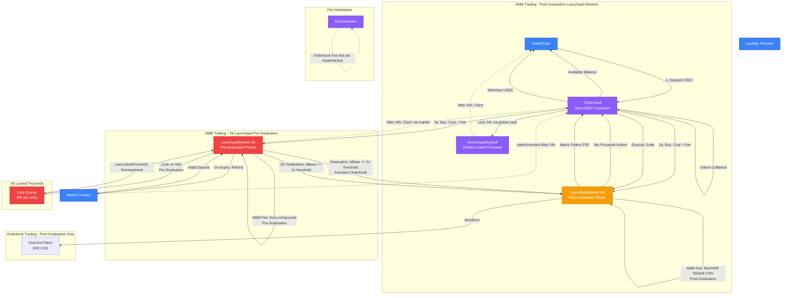

# Sooth Protocol Money Flow Diagram

## Key Money Flows

### 1. Deposit/Withdrawal
- **User → TraderVault**: Deposit USDC (available balance)
- **TraderVault → User**: Withdraw USDC

### 2. AMM Buy (Post-Graduation Launchpad Market)
- **TraderVault → LaunchpadMarket**: Cost + Fee
- **LaunchpadMarket**: Funds stay in market (market is its own vault)
- **LaunchpadMarket**: Fee accumulates in market reserve

### 3. AMM Sell (Post-Graduation Launchpad Market)
- **LaunchpadMarket**: Pays net proceeds (after fee) to TraderVault
- **TraderVault**: Locks proceeds for 24 hours via global SoothLiquidityVault
- **SoothLiquidityVault → User**: Unlocks after 24h (claimable)

### 4. AMM Buy (V6 Launchpad Pre-Graduation)
- **TraderVault → LaunchpadMarket**: Cost + Fee
- **LaunchpadMarket**: Fee auto-compounds into `bBase` (liquidity growth)
- **LaunchpadMarket**: Mints LP tokens 1:1 to trader (pre-graduation)
- **Locked Proceeds**: Can be used via `useLockedProceeds()` instead of available balance

### 5. AMM Sell (V6 Launchpad Pre-Graduation)
- **LaunchpadMarket**: Proceeds - Fee locked in market (FIFO queue, 24h per entry)
- **Locked Proceeds**: Can be reinvested immediately or claimed after 24h
- **LaunchpadMarket**: Fee auto-compounds into `bBase`

### 6. Orderbook Trading
- **TraderVault**: Locks collateral for orders
- **Market**: Matches orders peer-to-peer, mints/burns OutcomeTokens
- **TraderVault**: Unlocks collateral after match

### 7. Graduation (V6 Launchpad)
- When `bBase >= 2x threshold`: Launchpad market graduates to post-graduation phase
- Post-graduation: Orderbook activates, both AMM and Orderbook available
- Still a Launchpad market (not a separate market type)

### 8. Fees
- **AMM Fee Pre-Graduation**: Auto-compounds into `bBase` (liquidity growth), mints LP tokens 1:1
- **AMM Fee Post-Graduation**: `feeLMSR` (default 0.5%) - accumulates in market reserve
- **Orderbook Fee**: Not yet implemented (planned 0.1% with LP/treasury split)

### 9. Important V6 Architecture Notes
- **All markets are Launchpad markets** (no separate "standard market" type)
- **Pre-Graduation**: Locked proceeds stay in the market itself (FIFO queue)
- **Post-Graduation**: Locked proceeds managed via global `SoothLiquidityVault`
- **Market is its own vault**: Each Launchpad market implements `ISoothLiquidityVault` directly
- **SoothLiquidityVault**: Only used for global locked proceeds tracking, not market liquidity
