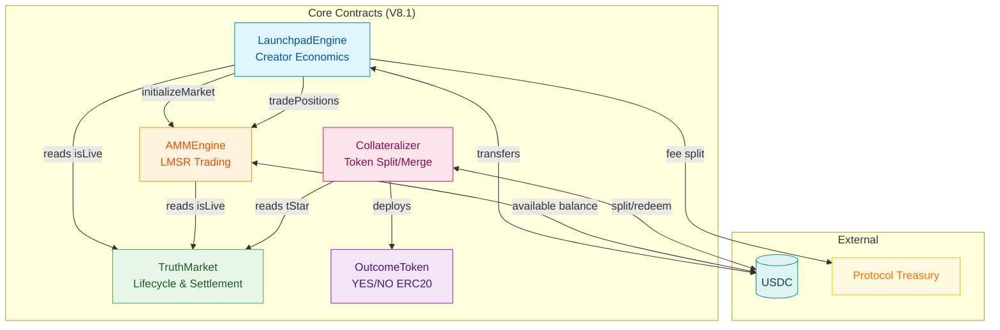
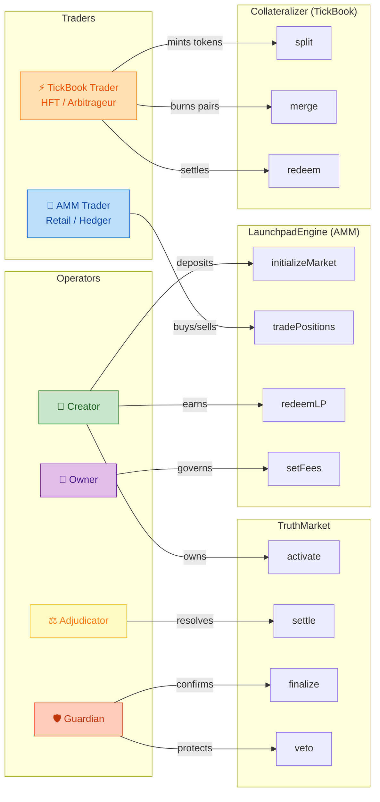
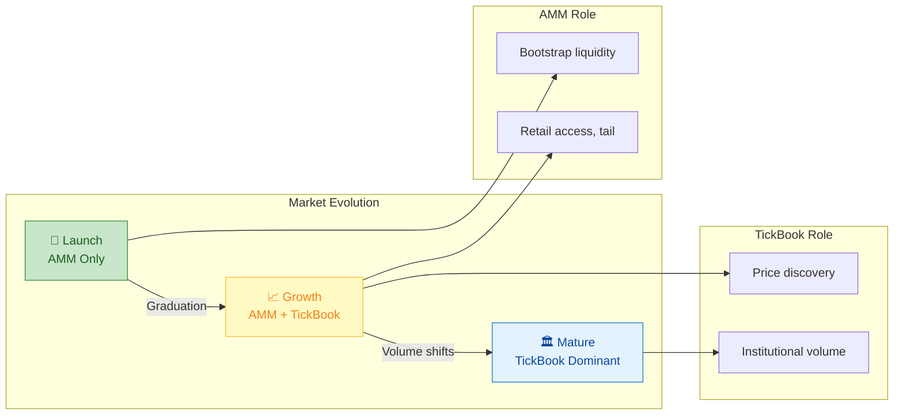
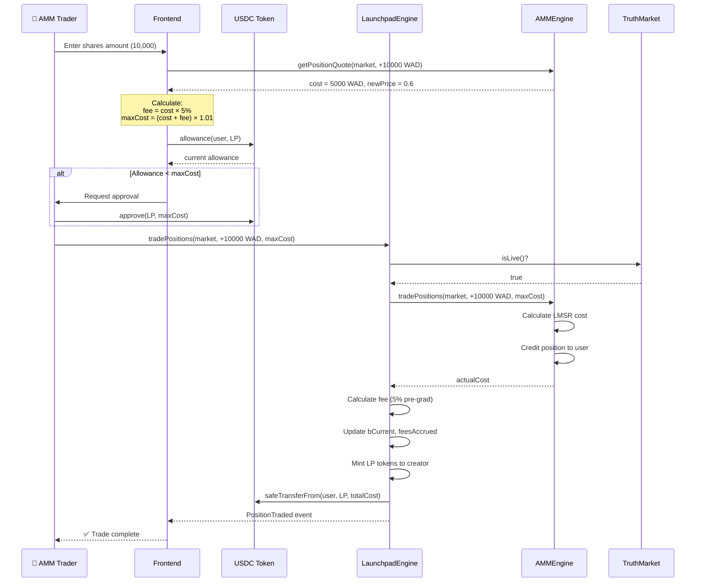
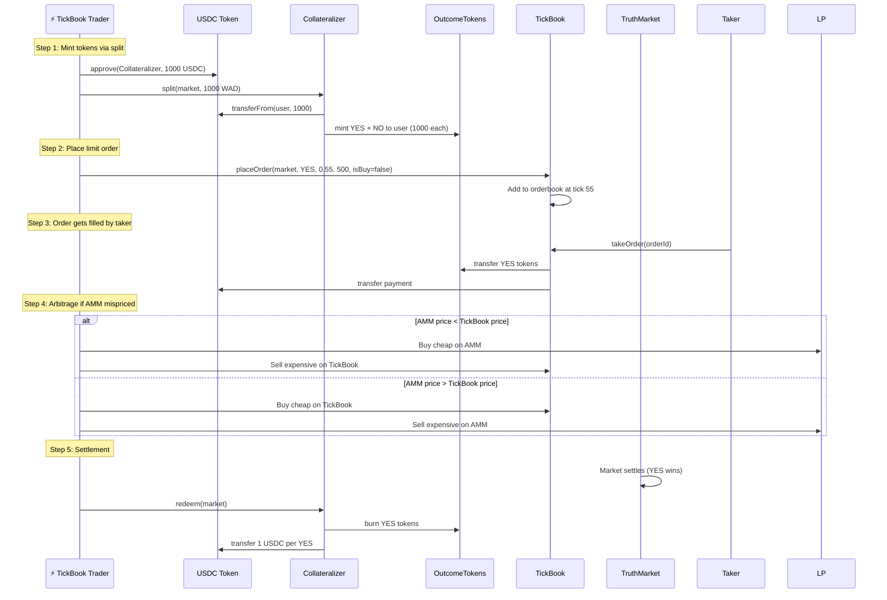
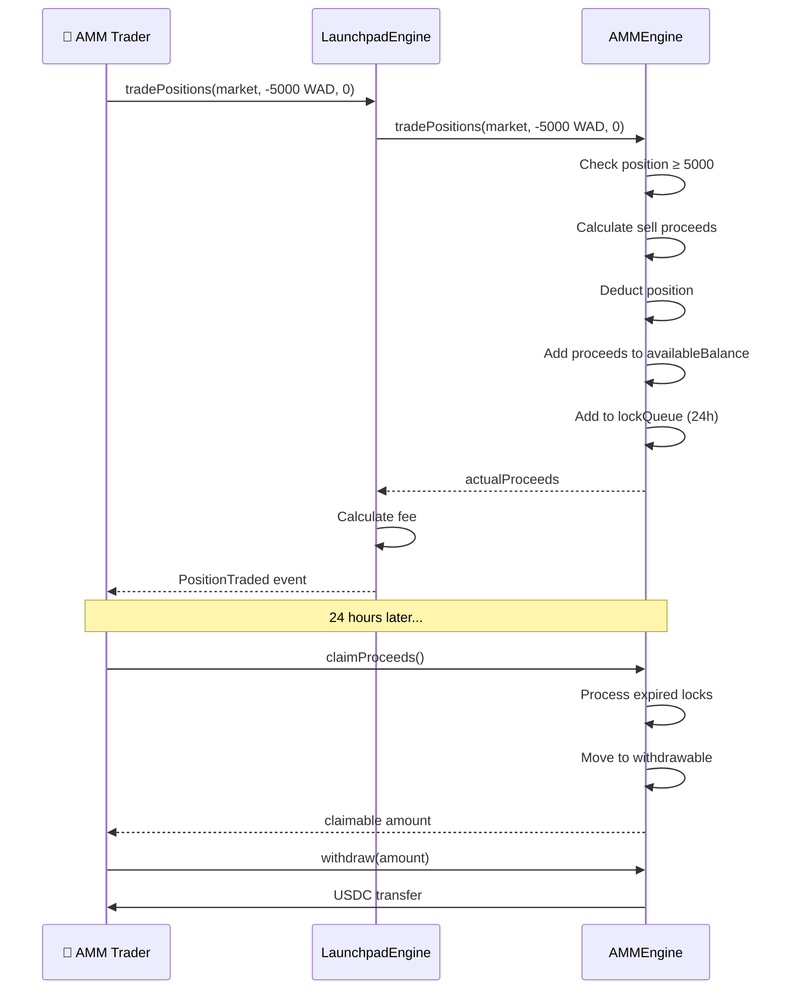
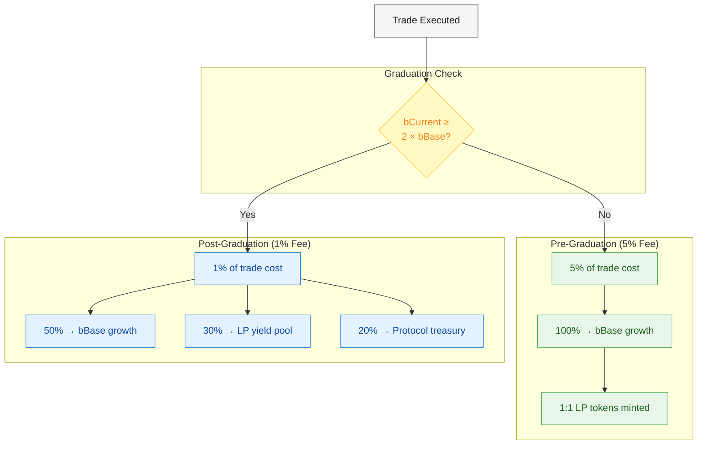
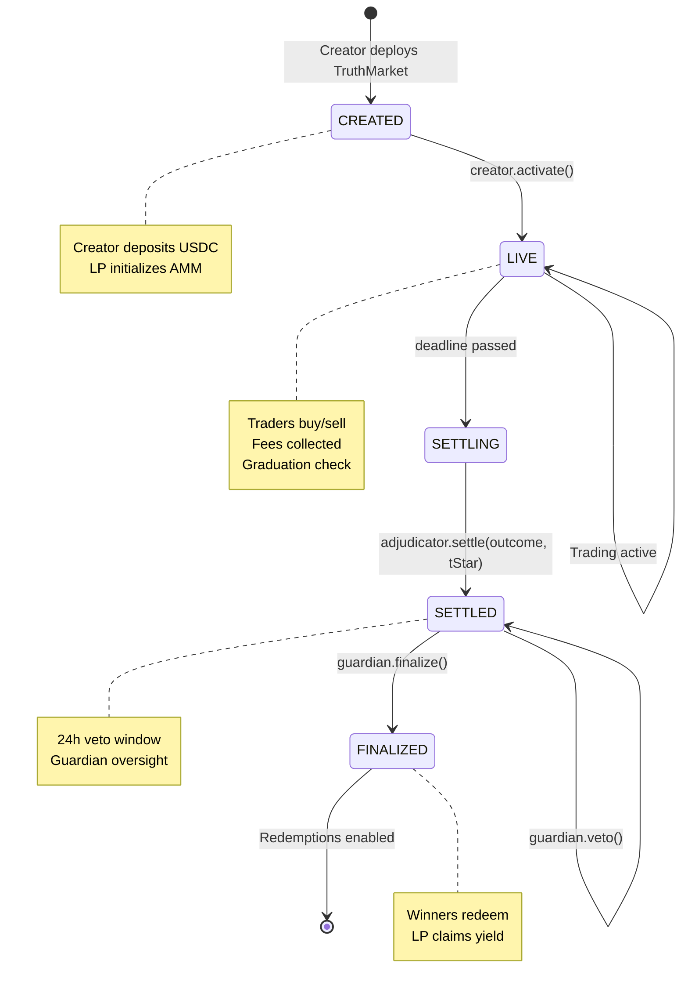
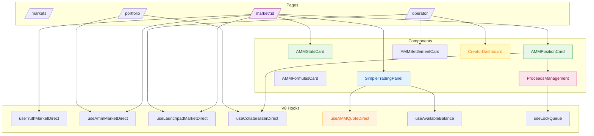
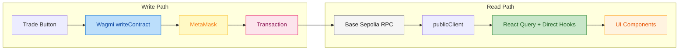

# V8.1 Actor Flow Diagrams

> Visual documentation of Sooth Protocol V8.1 architecture, actors, and data flows.

---

## 🏛️ 1. Contract Architecture



---

## 👥 2. Actor Roles & Permissions



---

## 🐢⚡ 2b. Two Trader Archetypes

The V8.1 dual-venue architecture serves **fundamentally different trader profiles**:

```mermaid
graph TB
    subgraph "🐢 AMM Trader (Retail)"
        AMM_WHO[Who: Retail users, hedgers, speculators]
        AMM_FREQ[Frequency: Low (LFT)]
        AMM_GOAL[Goal: Express opinion, hedge risk]
        AMM_SIZE[Size: Small to medium]
        AMM_TOOL[Tool: LaunchpadEngine]
        AMM_ASSET[Asset: Positions ledger entries]
        AMM_LOCK[Constraint: 24h sell lock]
    end

    subgraph "⚡ TickBook Trader (Pro)"
        OB_WHO[Who: Market makers, arbitrageurs, bots]
        OB_FREQ[Frequency: High (HFT)]
        OB_GOAL[Goal: Price discovery, arbitrage]
        OB_SIZE[Size: Large, rapid]
        OB_TOOL[Tool: Collateralizer + TickBook]
        OB_ASSET[Asset: ERC20 OutcomeTokens]
        OB_LOCK[Constraint: None - instant transfer]
    end

    style AMM_WHO fill:#e3f2fd,stroke:#1976d2,color:#0d47a1
    style AMM_FREQ fill:#e3f2fd,stroke:#1976d2,color:#0d47a1
    style AMM_GOAL fill:#e3f2fd,stroke:#1976d2,color:#0d47a1
    style AMM_SIZE fill:#e3f2fd,stroke:#1976d2,color:#0d47a1
    style AMM_TOOL fill:#e3f2fd,stroke:#1976d2,color:#0d47a1
    style AMM_ASSET fill:#e3f2fd,stroke:#1976d2,color:#0d47a1
    style AMM_LOCK fill:#e3f2fd,stroke:#1976d2,color:#0d47a1
    
    style OB_WHO fill:#fff3e0,stroke:#ff9800,color:#e65100
    style OB_FREQ fill:#fff3e0,stroke:#ff9800,color:#e65100
    style OB_GOAL fill:#fff3e0,stroke:#ff9800,color:#e65100
    style OB_SIZE fill:#fff3e0,stroke:#ff9800,color:#e65100
    style OB_TOOL fill:#fff3e0,stroke:#ff9800,color:#e65100
    style OB_ASSET fill:#fff3e0,stroke:#ff9800,color:#e65100
    style OB_LOCK fill:#fff3e0,stroke:#ff9800,color:#e65100
```

### Comparison Table

| Dimension | 🐢 AMM Trader | ⚡ TickBook Trader |
|-----------|--------------|-------------------|
| **Profile** | Retail, hedgers, opinion traders | MMs, arbitrageurs, HFT bots |
| **Frequency** | Low (hours/days) | High (seconds/blocks) |
| **Primary Goal** | Express view, hedge exposure | Price discovery, capture spreads |
| **Trade Size** | Small-medium (retail) | Large (institutional) |
| **Entry Point** | `LaunchpadEngine.tradePositions()` | `Collateralizer.split()` → TickBook |
| **Asset Type** | Non-transferable positions | Transferable ERC20 tokens |
| **Liquidity** | LMSR curve (always available) | Limit orderbook (depth varies) |
| **Sell Constraint** | 24h lock on proceeds | Instant (token transfer) |
| **Fee Model** | 5% pre-grad / 1% post-grad | Maker-taker spreads |
| **Settlement** | Automatic via position | Explicit token redemption |
| **UX Priority** | Simplicity, one-click trades | Speed, API access, depth |

### Why Two Venues?



**Pre-Graduation**: AMM bootstraps liquidity, TickBook disabled  
**Post-Graduation**: Both venues active, arbitrageurs keep prices aligned  
**Mature Market**: TickBook handles institutional flow, AMM serves retail tail

---

## 💱 3. AMM Trading Flow (🐢 Retail Trader)

> **Actor**: Retail user expressing opinion or hedging risk



---

## ⚡ 3b. TickBook Trading Flow (Pro Trader)

> **Actor**: Market maker or arbitrageur seeking price discovery and spread capture



### Key Differences from AMM Trading

| Aspect | AMM (🐢) | TickBook (⚡) |
|--------|----------|--------------|
| **Entry** | Direct trade | Split USDC → tokens first |
| **Asset** | Position ledger | ERC20 tokens (transferable) |
| **Pricing** | LMSR formula | Limit orderbook |
| **Execution** | Instant (vs curve) | Depends on depth |
| **Fees** | 5%/1% protocol fee | Maker-taker spread |
| **Sell Lock** | 24h on proceeds | None (instant transfer) |
| **Best For** | Retail, one-click | MMs, arb bots, API |

---

## 💸 4. AMM Sell Flow (🐢 With 24h Lock)

> **Constraint**: Sell proceeds are locked for 24 hours to prevent manipulation



---

## 🎓 5. Graduation & Fee Flow



---

## 🔄 6. Market Lifecycle



---

## 🏠 7. Frontend Component Flow



---

## 📊 8. Data Flow Summary



---

## 📋 Architecture Reference Table

| Layer | Contract | Trader Type | Responsibility |
|-------|----------|-------------|---------------|
| **Lifecycle** | `TruthMarket` | All | Question, deadline, settlement, roles |
| **AMM Trading** | `AMMEngine` | 🐢 Retail | LMSR pricing, positions, 24h locks |
| **Economics** | `LaunchpadEngine` | 🐢 Retail | Fees, LP tokens, graduation |
| **Token Ops** | `Collateralizer` | ⚡ Pro | Token split/merge, redemption |
| **Orderbook** | `TickBook` | ⚡ Pro | Limit orders, matching engine |
| **Tokens** | `OutcomeToken` | ⚡ Pro | Transferable ERC20 (OB-domain only) |

---

## 🎯 Key Design Principles

1. **Dual Trader Architecture**
   - 🐢 **AMM Traders** (Retail) → LaunchpadEngine → Non-transferable positions
   - ⚡ **TickBook Traders** (Pro) → Collateralizer → Transferable ERC20 tokens
   - Different constraints, fees, and UX for each archetype
   - Arbitrageurs bridge the two venues, keeping prices aligned

2. **Separation of Concerns**
   - `TruthMarket` = Source of truth (lifecycle only)
   - `AMMEngine` = Pure trading math (no economics)
   - `LaunchpadEngine` = Creator incentives wrapper
   - `Collateralizer` = Orderbook-domain token operations

3. **Pure WAD Architecture**
   - All internal math uses 18 decimals (WAD)
   - Conversion to token decimals only at transfer boundary
   - Consistent precision across all contracts

4. **Lock-on-Sell Model (AMM Only)**
   - Sell proceeds locked for 24 hours
   - Spendable immediately for new trades
   - Withdrawable after lock expires
   - TickBook has no lock (instant token transfer)

5. **Two-Phase Fee Model**
   - Pre-graduation: 5% → 100% to liquidity growth
   - Post-graduation: 1% → split (50/30/20)

---

*Generated: 2025-12-25 | Version: V8.1*

