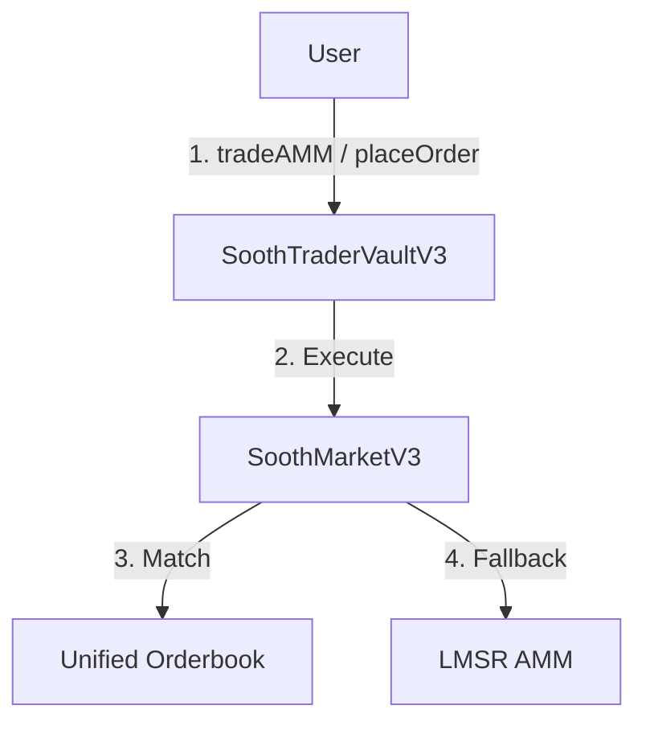

# Unified Orderbook Integration Guide

**Date:** 2025-12-04
**Status:** ✅ Live on Base Sepolia

> [!IMPORTANT] > **Architecture:** All interactions go through `SoothTraderVault`. You do NOT interact with `SoothMarket` directly.

## Overview

The v3 Unified Orderbook simplifies trading by merging the "Buy" and "Sell" sides into a single liquidity pool.

- **Sell YES** orders are automatically converted to **Buy NO** orders.
- **Sell NO** orders are automatically converted to **Buy YES** orders.
- There is no concept of "locking collateral" anymore. Users simply pay USDC to buy shares.

## Architecture



## Key Changes from v2

| Feature         | v2 (Legacy)                    | v3 (Current)                              |
| :-------------- | :----------------------------- | :---------------------------------------- |
| **Entry Point** | `SoothMarket`                  | `SoothTraderVaultV3`                      |
| **Selling**     | Requires locking collateral    | Just another "Buy" order (Buy Opposite)   |
| **Orderbook**   | Separate Bids/Asks per outcome | Single "Best Ask" / "Best Bid" per market |
| **Settlement**  | Claim collateral + winnings    | Claim winnings only                       |

## Contract Interfaces

### 1. Placing a Limit Order

Call `placeOrder` on `SoothTraderVaultV3`.

```solidity
function placeOrder(
    address market,
    uint8 outcome,   // 0 = YES, 1 = NO
    uint256 price,   // Price per share (1e18), e.g., 0.60 USDC
    uint256 amount   // Number of shares (1e18)
) external returns (uint256 orderId);
```

- **Cost:** You pay `price * amount` in USDC immediately.
- **Logic:**
  - If you buy **YES** at 0.60, it enters the orderbook as a **Bid** for YES.
  - If you buy **NO** at 0.40, it enters the orderbook as an **Ask** for YES at 0.60 (1 - 0.40).

### 2. Market Order (AMM + Orderbook)

Call `tradeAMM` on `SoothTraderVaultV3`.

```solidity
function tradeAMM(
    address market,
    uint8 outcome,       // 0 = YES, 1 = NO
    int256 deltaShares,  // Positive = Buy, Negative = Sell
    int256 maxCost       // Slippage protection
) external returns (int256 cost, uint256 fee);
```

- **Routing:** The contract automatically checks the orderbook first. If it can fill your order at a better price than the AMM, it does so.
- **Slippage:** `maxCost` is the maximum USDC you are willing to spend (for buys) or minimum you want to receive (for sells).

### 3. Cancelling an Order

Call `cancelOrder` on `SoothTraderVaultV3`.

```solidity
function cancelOrder(
    address market,
    uint256 orderId
) external returns (uint256 refund);
```

## Frontend Integration

### Fetching the Orderbook

The orderbook is stored as a linked list in `SoothMarketV3`.

```javascript
// Fetch top 50 orders
async function fetchOrderbook(marketAddress) {
  const market = new ethers.Contract(marketAddress, MARKET_ABI, provider);

  // Best Ask (Lowest price to Buy YES)
  let currentAskId = await market.bestAsk();
  const asks = [];
  while (currentAskId != 0 && asks.length < 50) {
    const order = await market.orders(currentAskId);
    asks.push({
      id: order.id,
      price: ethers.formatEther(order.yesPrice), // Price of YES
      amount: ethers.formatEther(order.amount),
    });
    currentAskId = await market.nextOrder(currentAskId);
  }

  // Best Bid (Highest price to Sell YES)
  let currentBidId = await market.bestBid();
  const bids = [];
  while (currentBidId != 0 && bids.length < 50) {
    const order = await market.orders(currentBidId);
    bids.push({
      id: order.id,
      price: ethers.formatEther(order.yesPrice), // Price of YES
      amount: ethers.formatEther(order.amount),
    });
    currentBidId = await market.nextOrder(currentBidId);
  }

  return { asks, bids };
}
```

### Displaying "Buy NO" Orders

Since the orderbook is unified around **YES Price**, you need to convert for UI if the user is looking at "NO".

- **If user wants to Buy NO:**
  - Show them **Bids for YES** (because selling YES = buying NO).
  - Display Price = `1 - yesPrice`.

| Orderbook Data     | UI (Buy YES)    | UI (Buy NO)    |
| :----------------- | :-------------- | :------------- |
| **Best Ask:** 0.60 | Buy YES @ 0.60  | Sell NO @ 0.40 |
| **Best Bid:** 0.58 | Sell YES @ 0.58 | Buy NO @ 0.42  |

## Events

Listen to these events on `SoothMarketV3` to update UI in real-time.

```solidity
event OrderCreated(uint256 indexed orderId, address indexed maker, uint8 outcome, uint256 price, uint256 amount);
event OrderMatched(uint256 indexed buyOrderId, uint256 indexed sellOrderId, uint256 amount, uint256 price);
event OrderCancelled(uint256 indexed orderId);
```
