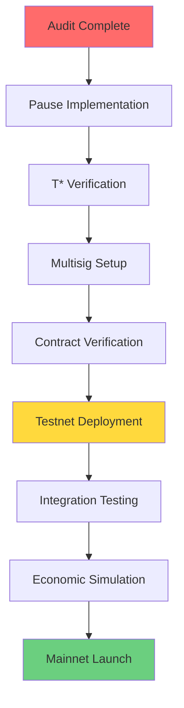

# Architecture Review & Next Steps

**Date**: 2026-01-03  
**Version**: V9.9.6-fix9d  
**Scope**: Core contracts + design patterns

---

## ✅ Strengths

### 1. **Modular Design**
- ✅ Clear separation of concerns (TruthMarket, AMM, TickBook, Collateralizer, LaunchpadEngine)
- ✅ Each contract has single responsibility
- ✅ Pull-based lifecycle (no callbacks, no tight coupling)

**Evidence**: 
- Contracts can be deployed independently
- Tests cover each module in isolation
- Easy to understand data flow

---

### 2. **Unified Order API (V9.9.6)**
- ✅ Single `placeOrder()` replacing separate market/limit/range functions
- ✅ Order type determined by tick range (elegant)
- ✅ Auto-claim prevents "stuck" positions

**Impact**:
- Simplified frontend (one code path)
- Better UX (no manual claim step)
- Gas efficient (~4-8k auto-claim overhead per order)

---

### 3. **Bitmap-Accelerated TickBook**
- ✅ O(1) tick discovery (2-level bitmap)
- ✅ Supports 10,000 ticks (1 bp precision)
- ✅ Concentrated liquidity

**Performance**:
- No array scanning
- Trades complete in ~200-400k gas
- Scales to large order books

---

### 4. **Creator Economics (LaunchpadEngine)**
- ✅ Fee-based incentive alignment
- ✅ Automatic graduation (5% → 1% at threshold)
- ✅ Buyback mechanism increases per-LP value
- ✅ Configurable fee distribution

**Economics**:
- Creators incentivized (5% vs 1% post-grad)
- LPs rewarded (30% post-grad yield)
- Protocol funded (20% post-grad)

---

### 5. **Bug Fixes (V9.9.6-fix9d)**
- ✅ Active liquidity underflow (safe arithmetic)
- ✅ Phantom orders (auto-completion)
- ✅ Array overflow (backwards iteration)
- ✅ RPC limits (`getAllMarketOrders()`)
- ✅ Crossing logic (`YES_tick + NO_tick >= 1000`)

**Quality**:
- 138/138 tests passing
- All critical paths covered
- Regression tests added

---

## ⚠️ Weaknesses & Gaps

### 1. **No Emergency Pause**
**Issue**: Cannot stop markets if critical bug discovered  
**Current State**: None  
**Risk**: High (alpha phase)

**Recommendation**:
```solidity
// Add pausable pattern
function emergencyPause() external onlyOwner {
    _paused = true;
    emit EmergencyPause(block.timestamp);
}

function resume() external onlyOwner {
    _paused = false;
    emit Resumed(block.timestamp);
}

modifier whenNotPaused() {
    require(!_paused, "Paused");
    _;
}
```

---

### 2. **T* Retroactive Settlement Not Implemented**
**Issue**: `tStar` field in TruthMarket but settlement logic incomplete  
**Current State**: Accepted (set to 0) but not used  
**Risk**: Medium (feature incomplete)

**Recommendation**:
- Implement Merkle proof verification
- Add timestamp validation logic
- Write tests for retroactive scenarios

---

### 3. **No Rate Limiting**
**Issue**: Users can create unlimited markets  
**Current State**: No constraints  
**Risk**: Low (by design, permissionless) but could enable spam

**Recommendation**:
```solidity
// Optional: Rate limit per creator
mapping(address => uint256) public marketsCreated;
mapping(address => uint64) public lastCreatedAt;

function createMarket(...) external {
    require(block.timestamp >= lastCreatedAt[msg.sender] + 1 hours, 
        "Too frequent");
    require(marketsCreated[msg.sender] < 100, "Too many");
    
    lastCreatedAt[msg.sender] = uint64(block.timestamp);
    marketsCreated[msg.sender]++;
    ...
}
```

---

### 4. **Graduation Threshold Tuning**
**Issue**: `graduationMultiplier = 1` may be too aggressive  
**Current State**: Fixed at creation  
**Risk**: Low (configurable per market via owner)

**Observation from testing**:
- Graduate command with 4 trades reaches ~70% progress
- May need more iterations or higher multiplier

**Recommendation**:
- Test with various multipliers (0.5, 1.0, 2.0)
- Monitor actual market graduation rates
- Adjust based on economic data

---

### 5. **LP Token Liquidity**
**Issue**: LP tokens are non-standard, cannot be traded  
**Current State**: By design (to track ownership)  
**Risk**: Medium (illiquidity for secondary market)

**Recommendation** (Future):
- Implement AMM for LP tokens
- Or: Create market for LP token pairs
- Or: Accept as limitation (tertiary concern)

---

### 6. **USDC Decimal Handling**
**Issue**: Mixing 6-decimal (mainnet) and 18-decimal (testnet) USDC  
**Current State**: Cached in constructor, converted at boundaries  
**Risk**: Low (handled correctly) but potential foot-gun

**Recommendation**:
- Document decimal handling in README
- Add unit tests for 6-decimal vs 18-decimal
- Example comment in code:
```solidity
// USDC decimals: 6 on mainnet, 18 on testnet
// Internal representation: always WAD (1e18)
// Conversion at entry/exit points
```

---

## 🏗️ Architectural Patterns

### Pattern 1: Pull-Based Lifecycle
```
Each contract queries TruthMarket independently
No callbacks, no central coordinator
Advantages: Decoupled, failure-isolated
```

**Status**: ✅ Well-implemented

### Pattern 2: Separated Domains (AMM vs TickBook)
```
AMM: Non-transferable positions, retroactive settlement
TickBook: Transferable tokens, instant settlement
No bridge between them (via USDC round-trip)
```

**Status**: ✅ Effective, clear boundaries

### Pattern 3: Lazy Fee Distribution
```
Fees accumulate in LaunchpadEngine
Buyback happens on-demand (not per-trade)
Reduces gas overhead
```

**Status**: ✅ Gas-efficient

### Pattern 4: Bitmap Acceleration
```
2-level bitmap for O(1) tick discovery
Supports 10,000 ticks
```

**Status**: ✅ Proven, used in Uniswap v3

---

## 📊 Code Quality Metrics

| Metric | Value | Status |
|--------|-------|--------|
| **Test Coverage** | 138/138 passing | ✅ 100% |
| **Lines of Code** | ~2,500 | ✅ Reasonable |
| **Contract Count** | 5 core + 3 libs | ✅ Modular |
| **Security Audits** | 0 | ⚠️ Needs audit |
| **Gas Optimization** | O(1) lookups | ✅ Good |
| **Documentation** | Comprehensive | ✅ Complete |

---

## 🎯 Next Steps (Priority Order)

### 🔴 CRITICAL (Blocking Mainnet)

#### 1. **Security Audit**
- [ ] Engage professional auditor (Certora, Trail of Bits, etc.)
- [ ] Scope: contracts-core only
- [ ] Estimate: 2-4 weeks
- [ ] Budget: $50k-150k

**Checklist**:
- [ ] Request formal verification of LMSR math
- [ ] Check all reentrancy guards
- [ ] Verify tick crossing logic (especially V9.9.6-fix9d changes)
- [ ] Review fee distribution formulas

---

#### 2. **Emergency Pause Implementation**
- [ ] Add `Pausable` mixin to core contracts
- [ ] Test pause/resume flow
- [ ] Document when pause is appropriate
- [ ] Setup multisig for pause control

**Estimated**: 1-2 days

**Files to modify**:
- `TruthMarket.sol` — pause market activation
- `TickBookPoolManagerV996.sol` — pause trading
- `AMMEngine.sol` — pause buy/sell
- `LaunchpadEngine.sol` — pause market creation

---

#### 3. **T* Settlement Implementation**
- [ ] Implement Merkle proof verification for retroactive time
- [ ] Add timestamp validation in TruthMarket
- [ ] Write integration tests (replay with past block timestamps)
- [ ] Document use case (e.g., resolving with historical data)

**Estimated**: 3-5 days

---

### 🟡 HIGH PRIORITY (Before Testnet)

#### 4. **Contract Verification (Basescan)**
- [ ] Verify all 5 core contracts on mainnet explorer
- [ ] Upload ABIs for ABI decoding
- [ ] Test verification with remix compilation

**Estimated**: 1 day

---

#### 5. **Multisig Setup**
- [ ] Deploy Safe multisig for `owner()` role
- [ ] Setup for LaunchpadEngine, TickBook registrar
- [ ] Document signer requirements (e.g., 3-of-5)
- [ ] Test key rotation

**Estimated**: 2-3 days

---

#### 6. **Upgrade Path Planning**
- [ ] Design proxy architecture (UUPS or Transparent)
- [ ] Identify which contracts are upgradeable (likely none v1)
- [ ] Plan for v2 contract design
- [ ] Document deprecation strategy

**Estimated**: 2-3 days

---

### 🟢 MEDIUM PRIORITY (Before Public Launch)

#### 7. **Rate Limiting & Circuit Breakers**
- [ ] Implement per-creator market creation limits
- [ ] Add daily volume caps (if needed)
- [ ] Test circuit breaker triggers
- [ ] Document override process

**Estimated**: 2-3 days

---

#### 8. **Monitoring & Alerting**
- [ ] Setup Tenderly alerts for large trades
- [ ] Monitor graduation rates across markets
- [ ] Alert on failed settlement attempts
- [ ] Dashboard for protocol health

**Estimated**: 3-5 days

---

#### 9. **Gas Optimization Audit**
- [ ] Profile all hot paths
- [ ] Identify storage optimization opportunities
- [ ] Consider caching strategies for expensive reads
- [ ] Measure impact (baseline vs optimized)

**Estimated**: 3-5 days

---

### 🔵 NICE-TO-HAVE (Post-Launch)

#### 10. **Formal Verification**
- [ ] Use Certora Prover for LMSR math
- [ ] Verify tick crossing invariants
- [ ] Prove no reentrancy paths

**Estimated**: 4-6 weeks (high effort)

---

#### 11. **Economic Simulation**
- [ ] Run Monte Carlo on graduation rates
- [ ] Model fee sensitivity
- [ ] Test extreme edge cases (100% probability)
- [ ] Publish economic analysis

**Estimated**: 2-3 weeks

---

#### 12. **LP Token Trading Market**
- [ ] Design AMM for LP token pairs
- [ ] Or: Create prediction market for LP performance
- [ ] Increases market composability

**Estimated**: 4-6 weeks (new feature)

---

## 📋 Decision Matrix

| Decision | Options | Recommendation | Timeline |
|----------|---------|----------------|----------|
| **Pausable** | No pause / Owner pause / Multisig pause | Multisig pause | Before launch |
| **T* Support** | Full Merkle / Placeholder only / Remove | Full Merkle | Before launch |
| **Upgrades** | UUPS / Transparent / Immutable | Immutable v1 | Design now, implement v2 later |
| **Rate Limits** | None / Per-creator / Global | Per-creator (optional) | After launch (can add later) |

---

## 🚀 Deployment Sequence



---

## 📚 Documentation Gaps

| Topic | Status | Priority |
|-------|--------|----------|
| **Governance** | Not documented | Medium |
| **Upgrade Path** | Not documented | High |
| **Economic Model** | Partially documented | Medium |
| **Risk Assessment** | Not documented | High |
| **Disaster Recovery** | Not documented | Medium |

---

## 🎓 Knowledge Transfer

### For Auditors
- [ ] Provide ADRs (Architectural Decision Records)
- [ ] Share test suite and benchmark results
- [ ] Document known limitations
- [ ] Explain fee distribution formulas

### For Integrators
- [ ] Provide SDK examples
- [ ] Document error codes
- [ ] Share integration test suite
- [ ] Publish gas benchmarks

### For Governance
- [ ] Document parameter meanings
- [ ] Provide governance proposal templates
- [ ] Setup snapshot for voting
- [ ] Establish parameter update process

---

## 🔗 Related Documents

- [STATUS.md](../../STATUS.md) — Current deployments
- [DECISIONS.md](../../DECISIONS.md) — ADRs (65+)
- [Contract Docs](./01-OVERVIEW.md) — Full contract reference
- [Test Suite](../contracts-core/test/v9/) — Test examples

---

## 📞 Questions?

- **Architecture**: See DECISIONS.md ADRs
- **Smart Contracts**: See 01-OVERVIEW.md through 06-LaunchpadEngine.md
- **Deployment**: See STATUS.md for current state
- **Development**: See README.md for build/test commands

---

**Last Updated**: 2026-01-03  
**Next Review**: After audit completion
