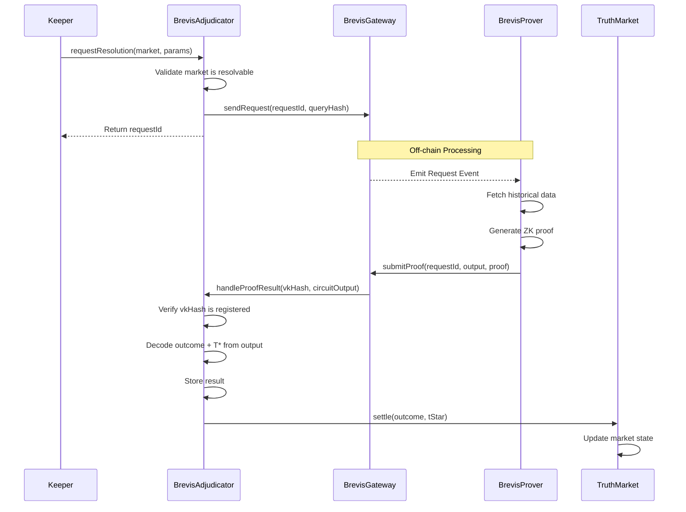
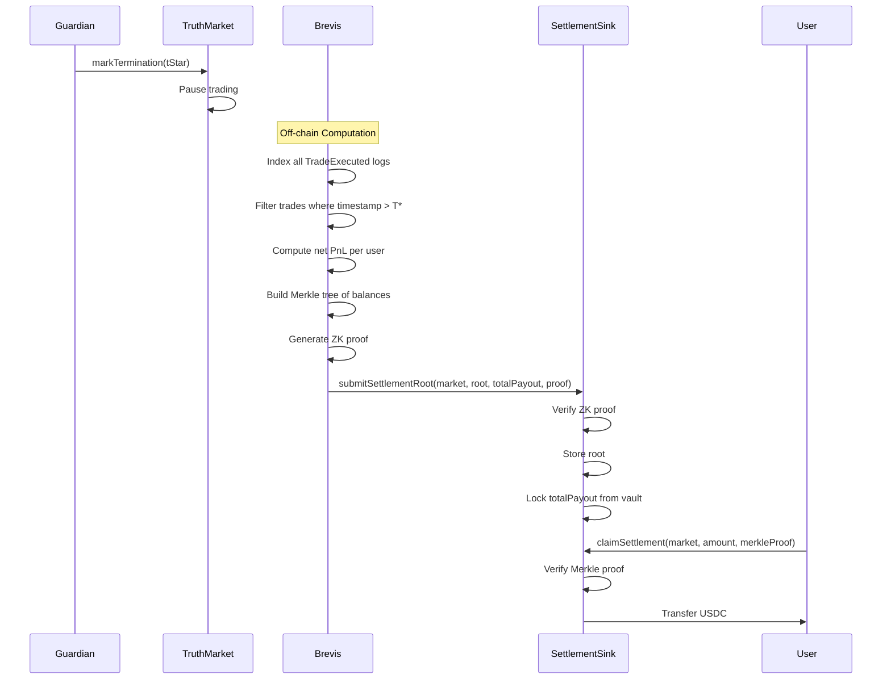

# Brevis Adjudicator Integration Specification

**Version**: 1.0.0  
**Status**: Draft  
**Last Updated**: 2026-01-07

---

## Table of Contents

1. [Executive Summary](#1-executive-summary)
2. [Architecture Overview](#2-architecture-overview)
3. [Use Case 1: ZK Adjudication](#3-use-case-1-zk-adjudication)
4. [Use Case 2: Retroactive Settlement](#4-use-case-2-retroactive-settlement)
5. [Interface Definitions](#5-interface-definitions)
6. [Security Considerations](#6-security-considerations)
7. [Implementation Phases](#7-implementation-phases)
8. [Test Cases](#8-test-cases)
9. [Appendix](#9-appendix)

---

## 1. Executive Summary

### Purpose

Integrate Brevis ZK coprocessor to enable **trustless market resolution** for Sooth Protocol prediction markets. This eliminates reliance on centralized oracles while enabling automated, mathematically-verified outcomes.

### Two Core Functions

| Function | Description | Trust Model |
|----------|-------------|-------------|
| **Adjudication** | Prove on-chain/web conditions to resolve markets | Trustless (ZK proof) |
| **Settlement** | Compute post-T* balances via Merkle root | Trustless (ZK proof) |

### Key Benefits

- **Trustless Resolution**: Math-verified outcomes, no human intervention
- **Instant Verification**: No challenge periods for ZK-Rule adjudicators
- **Scalable Settlement**: O(1) root submission, O(log N) user claims
- **Latency Protection**: T* mechanism prevents post-event arbitrage

### Supported Adjudicator Types

| Type | Trust Level | Speed | Use Cases |
|------|-------------|-------|-----------|
| ZK-Rule | Trustless | Fast | On-chain conditions (price thresholds, events) |
| ZK-Oracle | Trustless | Medium | Computed aggregates (TWAP, complex conditions) |
| Optimistic | Challengeable | Fast | Subjective events with dispute fallback |
| Multisig | Committee | Fast | Off-chain data, private outcomes |

---

## 2. Architecture Overview

### 2.1 Component Diagram

```
┌─────────────────────────────────────────────────────────────────────────┐
│                           SOOTH PROTOCOL                                │
├─────────────────────────────────────────────────────────────────────────┤
│                                                                         │
│  ┌─────────────────┐    ┌──────────────────────┐    ┌───────────────┐  │
│  │   TruthMarket   │◄───│  BrevisAdjudicator   │◄───│ BrevisGateway │  │
│  │                 │    │                      │    │   (Brevis)    │  │
│  │  • isLive()     │    │  • requestResolution │    │               │  │
│  │  • settle()     │    │  • handleProofResult │    │  • sendRequest│  │
│  │  • getOutcome() │    │  • getOutcome()      │    │  • callback   │  │
│  └────────┬────────┘    └──────────────────────┘    └───────────────┘  │
│           │                       ▲                         ▲          │
│           │                       │                         │          │
│           ▼                       │                         │          │
│  ┌─────────────────┐              │                         │          │
│  │ SettlementSink  │              │                         │          │
│  │                 │              │    ┌────────────────────┘          │
│  │  • submitRoot   │              │    │                               │
│  │  • claimSettle  │              │    │                               │
│  └─────────────────┘              │    │                               │
│                                   │    │                               │
└───────────────────────────────────┼────┼───────────────────────────────┘
                                    │    │
                          ┌─────────┴────┴─────────┐
                          │     BREVIS NETWORK     │
                          │                        │
                          │  ┌──────────────────┐  │
                          │  │  BrevisProver    │  │
                          │  │                  │  │
                          │  │  • Generate ZK   │  │
                          │  │    proofs        │  │
                          │  │  • Verify data   │  │
                          │  └──────────────────┘  │
                          │                        │
                          └────────────────────────┘
```

### 2.2 Integration Points

| Contract | Integration | Purpose |
|----------|-------------|---------|
| `TruthMarket` | Queries adjudicator for outcome | Lifecycle authority |
| `BrevisAdjudicator` | Receives proofs from Brevis | Resolution logic |
| `SettlementSink` | Accepts Merkle roots for T* settlement | Post-event accounting |
| `LaunchpadEngine` | References adjudicator during market creation | Creator selection |

### 2.3 Brevis SDK Components

| Component | Purpose | Import |
|-----------|---------|--------|
| `BrevisApp` | Base contract for Brevis integration | `@brevis-network/brevis-contracts` |
| `BrevisRequest` | On-chain request submission | SDK |
| `BrevisProof` | Proof verification utilities | SDK |

---

## 3. Use Case 1: ZK Adjudication

### 3.1 Overview

ZK Adjudication uses Brevis to **prove a condition was met** on-chain or via web data, then automatically resolves the market.

### 3.2 Adjudicator Types

#### Type A: ZK-Rule (On-Chain Conditions)

**Description**: Proves conditions using raw storage slots or event logs.

**Examples**:
- "Did BTC/USD price exceed $100,000?"
- "Did Aave Lending Pool emit a `Paused` event?"
- "Did this wallet receive > 100 ETH?"

**Trust Model**: Fully trustless — pure cryptographic verification.

**Brevis Role**: Direct read of historical chain state → ZK proof.

#### Type B: ZK-Oracle (Computed Logic)

**Description**: Aggregates multiple data points to prove complex derivative facts.

**Examples**:
- "Was the 7-day TWAP of ETH > $3,000?"
- "Did total DEX volume exceed $1B this week?"
- "Was the average gas price < 50 gwei for 24 hours?"

**Trust Model**: Trustless — computation proven via ZK.

**Brevis Role**: Ingests multiple data points off-chain → Computes aggregate → Proves result.

#### Type C: zkTLS (Web Data Attestations)

**Description**: Proves web data via TLS session attestations.

**Examples**:
- "Did this API endpoint return a specific value?"
- "Did this website show a particular result?"

**Trust Model**: Trustless with attestation assumptions.

**Brevis Role**: Web request via zkTLS → Attestation → ZK proof.

### 3.3 Resolution Flow



### 3.4 Circuit Specifications

#### Price Threshold Circuit

**Purpose**: Prove a price crossed a threshold at a specific time.

**Inputs**:
| Field | Type | Description |
|-------|------|-------------|
| `feedId` | bytes32 | Chainlink feed identifier |
| `threshold` | uint256 | Price threshold (WAD) |
| `timestampStart` | uint64 | Window start |
| `timestampEnd` | uint64 | Window end |

**Outputs**:
| Field | Type | Description |
|-------|------|-------------|
| `outcome` | uint8 | 0=NO, 1=YES, 2=INVALID |
| `tStar` | uint64 | Timestamp when condition was met |
| `marketAddress` | address | Market being resolved (for replay protection) |

**Pseudocode**:
```
circuit PriceThreshold(feedId, threshold, timestampStart, timestampEnd, market):
    prices = getChainlinkPrices(feedId, timestampStart, timestampEnd)
    
    for (price, timestamp) in prices:
        if price > threshold:
            return (outcome=YES, tStar=timestamp, market=market)
    
    if block.timestamp > timestampEnd:
        return (outcome=NO, tStar=timestampEnd, market=market)
    
    return (outcome=PENDING, tStar=0, market=market)
```

**vkHash Registration**:
```solidity
// During deployment or governance
adjudicator.registerVkHash(
    keccak256("PriceThreshold_v1"),
    CircuitType.ZK_RULE
);
```

---

## 4. Use Case 2: Retroactive Settlement

### 4.1 The T* Mechanism

#### Problem: Latency Arbitrage

When truth emerges (e.g., "BTC crossed $100k"), fast traders exploit stale AMM quotes before prices update:

```
Timeline:
├─ 14:00:00 — BTC crosses $100k (T* = this moment)
├─ 14:00:05 — News breaks publicly
├─ 14:00:10 — Arbitrageur buys YES at 60¢ (stale price)
├─ 14:00:30 — Market updates to 95¢
└─ Result: Arbitrageur profits at LP expense
```

#### Solution: Retroactive Finality

Sooth adjudicators report not just the outcome, but **when** it became true (T*). Settlement economically "rewinds" trades after T*:

```
With T* Mechanism:
├─ 14:00:00 — BTC crosses $100k (T* = this moment)
├─ 14:00:10 — Arbitrageur buys YES at 60¢
├─ 14:00:30 — Adjudicator reports: "YES, T* = 14:00:00"
└─ Settlement: The 14:00:10 trade is REWOUND
    → Arbitrageur receives refund, not windfall
    → LPs protected from latency exploitation
```

### 4.2 Settlement Root Architecture

Instead of updating every user's balance on-chain (O(N) gas), Brevis proves a **Merkle Root** of the final state. Users claim via Merkle proofs.

```
                    ┌──────────────────┐
                    │   Merkle Root    │
                    │  (submitted to   │
                    │   chain once)    │
                    └────────┬─────────┘
                             │
              ┌──────────────┼──────────────┐
              │              │              │
         ┌────┴────┐    ┌────┴────┐    ┌────┴────┐
         │ User A  │    │ User B  │    │ User C  │
         │ $1,234  │    │ $567    │    │ $890    │
         └─────────┘    └─────────┘    └─────────┘

Gas Costs:
- Submit root: O(1) — single transaction
- User claim: O(log N) — Merkle proof verification
```

### 4.3 Settlement Flow



### 4.4 Settlement Circuit Specification

**Purpose**: Compute final user balances after rewinding post-T* trades.

**Inputs**:
| Field | Type | Description |
|-------|------|-------------|
| `marketAddress` | address | Market being settled |
| `tStar` | uint64 | Termination timestamp |
| `tradeLogsRoot` | bytes32 | Commitment to trade event logs |

**Outputs**:
| Field | Type | Description |
|-------|------|-------------|
| `merkleRoot` | bytes32 | Root of user→balance tree |
| `totalPayout` | uint256 | Sum of all balances |
| `numUsers` | uint32 | Number of users in tree |

**Computation Logic**:
```
circuit SettlementComputation(market, tStar, logsRoot):
    trades = fetchTradeEvents(market, logsRoot)
    
    userBalances = {}
    
    for trade in trades:
        if trade.timestamp <= tStar:
            # Valid trade — apply to balance
            userBalances[trade.user] += trade.pnl
        else:
            # Post-T* trade — REWIND
            userBalances[trade.user] += trade.refundAmount
    
    merkleTree = buildMerkleTree(userBalances)
    totalPayout = sum(userBalances.values())
    
    return (merkleTree.root, totalPayout, len(userBalances))
```

---

## 5. Interface Definitions

### 5.1 IBrevisAdjudicator.sol

```solidity
// SPDX-License-Identifier: MIT
pragma solidity ^0.8.20;

/**
 * @title IBrevisAdjudicator
 * @notice Interface for Brevis-powered market resolution
 */
interface IBrevisAdjudicator {
    // ═══════════════════════════════════════════════════════════════════
    //                              ENUMS
    // ═══════════════════════════════════════════════════════════════════

    enum RequestStatus {
        None,       // No request exists
        Pending,    // Request submitted, awaiting proof
        Resolved,   // Proof verified, outcome stored
        Failed      // Proof failed or timed out
    }

    enum CircuitType {
        ZK_RULE,    // On-chain condition proofs
        ZK_ORACLE,  // Computed aggregate proofs
        ZK_TLS,     // Web data attestations
        SETTLEMENT  // T* settlement computation
    }

    // ═══════════════════════════════════════════════════════════════════
    //                              EVENTS
    // ═══════════════════════════════════════════════════════════════════

    /**
     * @notice Emitted when resolution is requested
     * @param requestId Unique identifier for this request
     * @param market Market being resolved
     * @param queryHash Hash of query parameters
     */
    event ResolutionRequested(
        bytes32 indexed requestId,
        address indexed market,
        bytes32 queryHash
    );

    /**
     * @notice Emitted when market is resolved
     * @param market Market that was resolved
     * @param outcome Resolution outcome (0=NO, 1=YES, 2=INVALID)
     * @param tStar Timestamp when outcome became true
     */
    event MarketResolved(
        address indexed market,
        uint8 outcome,
        uint64 tStar
    );

    /**
     * @notice Emitted when a vkHash is registered
     * @param vkHash Verification key hash
     * @param circuitType Type of circuit
     */
    event VkHashRegistered(
        bytes32 indexed vkHash,
        CircuitType circuitType
    );

    // ═══════════════════════════════════════════════════════════════════
    //                           FUNCTIONS
    // ═══════════════════════════════════════════════════════════════════

    /**
     * @notice Request Brevis to verify a condition for market resolution
     * @param market The market to resolve
     * @param queryParams Encoded parameters (feed ID, threshold, time range, etc.)
     * @return requestId Unique identifier for tracking this request
     */
    function requestResolution(
        address market,
        bytes calldata queryParams
    ) external payable returns (bytes32 requestId);

    /**
     * @notice Get the resolution outcome for a market
     * @param market The market to query
     * @return resolved Whether the market has been resolved
     * @return outcome The outcome (0=NO, 1=YES, 2=INVALID)
     * @return tStar The timestamp when outcome became true
     */
    function getOutcome(address market)
        external
        view
        returns (bool resolved, uint8 outcome, uint64 tStar);

    /**
     * @notice Get the status of a resolution request
     * @param requestId The request to query
     * @return status Current status of the request
     */
    function getRequestStatus(bytes32 requestId)
        external
        view
        returns (RequestStatus status);

    /**
     * @notice Register a verification key hash for approved circuits
     * @param vkHash The verification key hash
     * @param circuitType The type of circuit
     */
    function registerVkHash(bytes32 vkHash, CircuitType circuitType) external;

    /**
     * @notice Check if a vkHash is registered
     * @param vkHash The verification key hash to check
     * @return registered Whether the vkHash is registered
     * @return circuitType The type if registered
     */
    function isVkHashRegistered(bytes32 vkHash)
        external
        view
        returns (bool registered, CircuitType circuitType);
}
```

### 5.2 ISettlementSink.sol

```solidity
// SPDX-License-Identifier: MIT
pragma solidity ^0.8.20;

/**
 * @title ISettlementSink
 * @notice Interface for T* retroactive settlement
 */
interface ISettlementSink {
    // ═══════════════════════════════════════════════════════════════════
    //                              EVENTS
    // ═══════════════════════════════════════════════════════════════════

    /**
     * @notice Emitted when a settlement root is submitted
     * @param market The market being settled
     * @param merkleRoot Root of the user→balance tree
     * @param totalPayout Total USDC required for settlement
     */
    event SettlementRootSubmitted(
        address indexed market,
        bytes32 merkleRoot,
        uint256 totalPayout
    );

    /**
     * @notice Emitted when a user claims their settlement
     * @param market The market
     * @param user The user claiming
     * @param amount Amount claimed
     */
    event SettlementClaimed(
        address indexed market,
        address indexed user,
        uint256 amount
    );

    // ═══════════════════════════════════════════════════════════════════
    //                           FUNCTIONS
    // ═══════════════════════════════════════════════════════════════════

    /**
     * @notice Submit a ZK-proven settlement root from Brevis
     * @param market The market being settled
     * @param merkleRoot Root of the tree: {user → amountUSDC}
     * @param totalPayout Total USDC required for this settlement
     * @param proof ZK proof verifying the computation
     */
    function submitSettlementRoot(
        address market,
        bytes32 merkleRoot,
        uint256 totalPayout,
        bytes calldata proof
    ) external;

    /**
     * @notice User claims their share from the settlement
     * @param market The market to claim from
     * @param amount The amount to claim
     * @param merkleProof Proof of inclusion in the settlement tree
     */
    function claimSettlement(
        address market,
        uint256 amount,
        bytes32[] calldata merkleProof
    ) external;

    /**
     * @notice Check if a user has claimed their settlement
     * @param market The market
     * @param user The user to check
     * @return claimed Whether the user has claimed
     */
    function hasClaimed(address market, address user)
        external
        view
        returns (bool claimed);

    /**
     * @notice Get settlement info for a market
     * @param market The market to query
     * @return root The Merkle root
     * @return totalPayout Total payout amount
     * @return claimed Amount already claimed
     */
    function getSettlementInfo(address market)
        external
        view
        returns (bytes32 root, uint256 totalPayout, uint256 claimed);
}
```

### 5.3 BrevisAdjudicator.sol (Implementation Skeleton)

```solidity
// SPDX-License-Identifier: MIT
pragma solidity ^0.8.20;

import {BrevisApp} from "@brevis-network/brevis-contracts/BrevisApp.sol";
import {IBrevisAdjudicator} from "./interfaces/IBrevisAdjudicator.sol";
import {ITruthMarket} from "./interfaces/ITruthMarket.sol";
import {Ownable} from "@openzeppelin/contracts/access/Ownable.sol";

/**
 * @title BrevisAdjudicator
 * @notice Brevis-powered trustless market resolution
 */
contract BrevisAdjudicator is BrevisApp, IBrevisAdjudicator, Ownable {
    // ═══════════════════════════════════════════════════════════════════
    //                              STORAGE
    // ═══════════════════════════════════════════════════════════════════

    /// @notice Mapping of vkHash → CircuitType
    mapping(bytes32 => CircuitType) public registeredCircuits;
    
    /// @notice Mapping of requestId → market address
    mapping(bytes32 => address) public requestToMarket;
    
    /// @notice Mapping of market → resolution result
    mapping(address => Resolution) public resolutions;
    
    /// @notice Mapping of requestId → status
    mapping(bytes32 => RequestStatus) public requestStatuses;

    struct Resolution {
        bool resolved;
        uint8 outcome;
        uint64 tStar;
    }

    // ═══════════════════════════════════════════════════════════════════
    //                            CONSTRUCTOR
    // ═══════════════════════════════════════════════════════════════════

    constructor(address brevisRequest_) BrevisApp(brevisRequest_) {}

    // ═══════════════════════════════════════════════════════════════════
    //                         EXTERNAL FUNCTIONS
    // ═══════════════════════════════════════════════════════════════════

    /// @inheritdoc IBrevisAdjudicator
    function requestResolution(
        address market,
        bytes calldata queryParams
    ) external payable returns (bytes32 requestId) {
        require(!resolutions[market].resolved, "Already resolved");
        
        // Generate unique request ID
        requestId = keccak256(abi.encodePacked(market, block.timestamp, msg.sender));
        
        // Store mapping
        requestToMarket[requestId] = market;
        requestStatuses[requestId] = RequestStatus.Pending;
        
        // Submit to Brevis (implementation depends on SDK)
        bytes32 queryHash = keccak256(queryParams);
        // brevisRequest.sendRequest{value: msg.value}(requestId, queryHash);
        
        emit ResolutionRequested(requestId, market, queryHash);
    }

    /// @inheritdoc IBrevisAdjudicator
    function getOutcome(address market)
        external
        view
        returns (bool resolved, uint8 outcome, uint64 tStar)
    {
        Resolution memory res = resolutions[market];
        return (res.resolved, res.outcome, res.tStar);
    }

    /// @inheritdoc IBrevisAdjudicator
    function getRequestStatus(bytes32 requestId)
        external
        view
        returns (RequestStatus)
    {
        return requestStatuses[requestId];
    }

    /// @inheritdoc IBrevisAdjudicator
    function registerVkHash(bytes32 vkHash, CircuitType circuitType) 
        external 
        onlyOwner 
    {
        registeredCircuits[vkHash] = circuitType;
        emit VkHashRegistered(vkHash, circuitType);
    }

    /// @inheritdoc IBrevisAdjudicator
    function isVkHashRegistered(bytes32 vkHash)
        external
        view
        returns (bool registered, CircuitType circuitType)
    {
        circuitType = registeredCircuits[vkHash];
        registered = circuitType != CircuitType(0) || vkHash == bytes32(0);
    }

    // ═══════════════════════════════════════════════════════════════════
    //                         BREVIS CALLBACK
    // ═══════════════════════════════════════════════════════════════════

    /**
     * @notice Callback from Brevis with proof result
     * @dev CRITICAL: Only callable by Brevis gateway
     * @param _vkHash Verification key hash of the circuit
     * @param _circuitOutput Encoded output from the circuit
     */
    function handleProofResult(
        bytes32 _vkHash,
        bytes calldata _circuitOutput
    ) internal override {
        // Verify vkHash is registered
        require(registeredCircuits[_vkHash] != CircuitType(0), "Unknown vkHash");
        
        // Decode circuit output
        (
            address market,
            uint8 outcome,
            uint64 tStar
        ) = abi.decode(_circuitOutput, (address, uint8, uint64));
        
        // Verify market hasn't been resolved
        require(!resolutions[market].resolved, "Already resolved");
        
        // Store resolution
        resolutions[market] = Resolution({
            resolved: true,
            outcome: outcome,
            tStar: tStar
        });
        
        // Notify TruthMarket
        ITruthMarket(market).settle(outcome, tStar);
        
        emit MarketResolved(market, outcome, tStar);
    }
}
```

---

## 6. Security Considerations

### 6.1 Threat Model

| Threat | Attack Vector | Impact | Mitigation |
|--------|---------------|--------|------------|
| Unauthorized Callback | Attacker calls `handleProofResult` directly | False resolution | `msg.sender == BREVIS_GATEWAY` check |
| Invalid Circuit | Attacker submits proof with unregistered vkHash | Arbitrary resolution | vkHash whitelist |
| Replay Attack | Reuse proof for different market | Double resolution | Include `market` in circuit output |
| Double Resolution | Call `settle()` twice | State corruption | `resolved` flag check |
| Front-running | MEV bot front-runs proof submission | Outcome manipulation | Proof includes market address |

### 6.2 Security Checklist

- [ ] `handleProofResult` verifies `msg.sender == brevisGateway`
- [ ] `vkHash` must be registered before use
- [ ] Circuit output includes `market` address for replay protection
- [ ] Market cannot be resolved twice
- [ ] Request fee prevents spam
- [ ] Owner functions are timelocked for mainnet

### 6.3 Callback Security Pattern

```solidity
function handleProofResult(
    bytes32 _vkHash,
    bytes calldata _circuitOutput
) internal override {
    // SECURITY: Verify caller is Brevis gateway
    // This check is inherited from BrevisApp base contract
    // BrevisApp.handleProofResult already validates msg.sender
    
    // SECURITY: Verify circuit is approved
    require(registeredCircuits[_vkHash] != CircuitType(0), "Unknown vkHash");
    
    // SECURITY: Decode and verify market from output (replay protection)
    (address market, uint8 outcome, uint64 tStar) = abi.decode(...);
    
    // SECURITY: Prevent double resolution
    require(!resolutions[market].resolved, "Already resolved");
    
    // ... proceed with resolution
}
```

### 6.4 Economic Security

| Parameter | Recommended Value | Rationale |
|-----------|-------------------|-----------|
| Request Fee | 0.01 ETH | Prevents spam requests |
| Proof Timeout | 24 hours | Allows retry if prover fails |
| vkHash Registration | Timelock 48h | Governance review period |

---

## 7. Implementation Phases

### Phase 1: Mock Adjudicator (Week 1-2)

**Goal**: Interface-compliant mock for testing.

**Deliverables**:
- [ ] `MockBrevisAdjudicator.sol` with god-mode `resolve()`
- [ ] Full `IBrevisAdjudicator` interface compliance
- [ ] Integration tests with TruthMarket
- [ ] Event emission verification

**Mock Implementation**:
```solidity
contract MockBrevisAdjudicator is IBrevisAdjudicator {
    mapping(address => Resolution) public resolutions;
    
    // GOD MODE: For testing only
    function mockResolve(address market, uint8 outcome, uint64 tStar) external {
        resolutions[market] = Resolution(true, outcome, tStar);
        ITruthMarket(market).settle(outcome, tStar);
        emit MarketResolved(market, outcome, tStar);
    }
}
```

### Phase 2: Testnet Integration (Week 3-6)

**Goal**: Connect to Brevis testnet with real proofs.

**Deliverables**:
- [ ] Deploy `BrevisAdjudicator` to testnet
- [ ] Register price threshold circuit vkHash
- [ ] End-to-end resolution flow
- [ ] Gas benchmarking

**Testnet Checklist**:
- [ ] Brevis testnet gateway address configured
- [ ] Test circuit deployed and vkHash registered
- [ ] Fee estimation implemented
- [ ] Error handling for failed proofs

### Phase 3: Settlement Engine (Week 7-10)

**Goal**: Implement T* retroactive settlement.

**Deliverables**:
- [ ] `SettlementSink.sol` contract
- [ ] Merkle tree generation (off-chain)
- [ ] User claim flow
- [ ] Gas optimization for claims

**Settlement Checklist**:
- [ ] Merkle proof verification
- [ ] Double-claim prevention
- [ ] Total payout accounting
- [ ] Integration with TickBookVault

### Phase 4: Production Hardening (Week 11-14)

**Goal**: Mainnet-ready deployment.

**Deliverables**:
- [ ] Security audit completion
- [ ] Timelock governance for vkHash registration
- [ ] Emergency pause mechanism
- [ ] Monitoring and alerting

---

## 8. Test Cases

### 8.1 Unit Tests

```solidity
// BrevisAdjudicator.t.sol

function test_RegisterVkHash_OnlyOwner() public {
    vm.prank(randomUser);
    vm.expectRevert("Ownable: caller is not the owner");
    adjudicator.registerVkHash(vkHash, CircuitType.ZK_RULE);
}

function test_RegisterVkHash_EmitsEvent() public {
    vm.expectEmit(true, false, false, true);
    emit VkHashRegistered(vkHash, CircuitType.ZK_RULE);
    adjudicator.registerVkHash(vkHash, CircuitType.ZK_RULE);
}

function test_HandleProofResult_RejectsUnregisteredVkHash() public {
    vm.prank(brevisGateway);
    vm.expectRevert("Unknown vkHash");
    adjudicator.handleProofResult(unregisteredVkHash, output);
}

function test_HandleProofResult_RejectsDoubleResolution() public {
    // First resolution
    vm.prank(brevisGateway);
    adjudicator.handleProofResult(vkHash, output);
    
    // Second attempt
    vm.prank(brevisGateway);
    vm.expectRevert("Already resolved");
    adjudicator.handleProofResult(vkHash, output);
}

function test_GetOutcome_ReturnsCorrectValues() public {
    // Resolve market
    vm.prank(brevisGateway);
    adjudicator.handleProofResult(vkHash, output);
    
    (bool resolved, uint8 outcome, uint64 tStar) = adjudicator.getOutcome(market);
    assertTrue(resolved);
    assertEq(outcome, 1); // YES
    assertEq(tStar, expectedTimestamp);
}
```

### 8.2 Integration Tests

```solidity
// BrevisIntegration.t.sol

function test_E2E_PriceThresholdResolution() public {
    // 1. Create market with Brevis adjudicator
    address market = createMarket(address(adjudicator));
    
    // 2. Request resolution
    bytes memory params = abi.encode(feedId, threshold, startTime, endTime);
    bytes32 requestId = adjudicator.requestResolution(market, params);
    
    // 3. Simulate Brevis callback
    bytes memory output = abi.encode(market, uint8(1), uint64(block.timestamp));
    vm.prank(brevisGateway);
    adjudicator.handleProofResult(vkHash, output);
    
    // 4. Verify market is settled
    assertTrue(ITruthMarket(market).isSettled());
    assertEq(ITruthMarket(market).outcome(), 1);
}

function test_E2E_SettlementClaim() public {
    // 1. Submit settlement root
    bytes32 root = computeMerkleRoot(userBalances);
    settlementSink.submitSettlementRoot(market, root, totalPayout, proof);
    
    // 2. User claims with Merkle proof
    bytes32[] memory proof = computeProof(user, amount);
    vm.prank(user);
    settlementSink.claimSettlement(market, amount, proof);
    
    // 3. Verify user received funds
    assertEq(usdc.balanceOf(user), amount);
    assertTrue(settlementSink.hasClaimed(market, user));
}
```

### 8.3 Invariant Tests

```solidity
// BrevisInvariants.t.sol

function invariant_NoDoubleResolution() public {
    for (uint i = 0; i < markets.length; i++) {
        (bool resolved,,) = adjudicator.getOutcome(markets[i]);
        if (resolved) {
            // Attempting to resolve again should fail
            vm.expectRevert();
            adjudicator.handleProofResult(vkHash, encodeOutput(markets[i]));
        }
    }
}

function invariant_ClaimsSumToTotalPayout() public {
    for (uint i = 0; i < settledMarkets.length; i++) {
        (,uint256 totalPayout, uint256 claimed) = 
            settlementSink.getSettlementInfo(settledMarkets[i]);
        assertLe(claimed, totalPayout);
    }
}

function invariant_OnlyRegisteredVkHashAccepted() public {
    // All resolutions must use registered vkHash
    // Verified through event analysis
}
```

---

## 9. Appendix

### 9.1 Brevis SDK Reference

**Installation**:
```bash
npm install @brevis-network/brevis-contracts
```

**Key Imports**:
```solidity
import {BrevisApp} from "@brevis-network/brevis-contracts/BrevisApp.sol";
import {IBrevisRequest} from "@brevis-network/brevis-contracts/IBrevisRequest.sol";
```

**BrevisApp Base Contract**:
- Handles `msg.sender` validation for callbacks
- Provides `handleProofResult` virtual function
- Manages Brevis gateway reference

### 9.2 Gas Benchmarks

| Operation | Gas Cost | Notes |
|-----------|----------|-------|
| `requestResolution` | ~50,000 | Plus Brevis fee |
| `handleProofResult` | ~80,000 | Includes TruthMarket.settle() |
| `submitSettlementRoot` | ~60,000 | One-time per market |
| `claimSettlement` | ~45,000 | Merkle proof verification |

### 9.3 Error Codes

| Error | Description |
|-------|-------------|
| `AlreadyResolved` | Market has already been resolved |
| `UnknownVkHash` | Verification key not registered |
| `InvalidProof` | ZK proof verification failed |
| `NotBrevisGateway` | Caller is not Brevis gateway |
| `AlreadyClaimed` | User has already claimed settlement |
| `InvalidMerkleProof` | Merkle proof does not verify |

### 9.4 References

- [Brevis Documentation](https://docs.brevis.network/)
- [Brevis SDK Repository](https://github.com/brevis-network/brevis-contracts)
- [Sooth Protocol BREVIS_ADJUDICATOR_DESIGN.md](../../packages/contracts-core/docs/Partnership/Brevis/BREVIS_ADJUDICATOR_DESIGN.md)

---

**Document Status**: Draft  
**Next Review**: After Phase 1 completion  
**Owner**: Sooth Protocol Team
