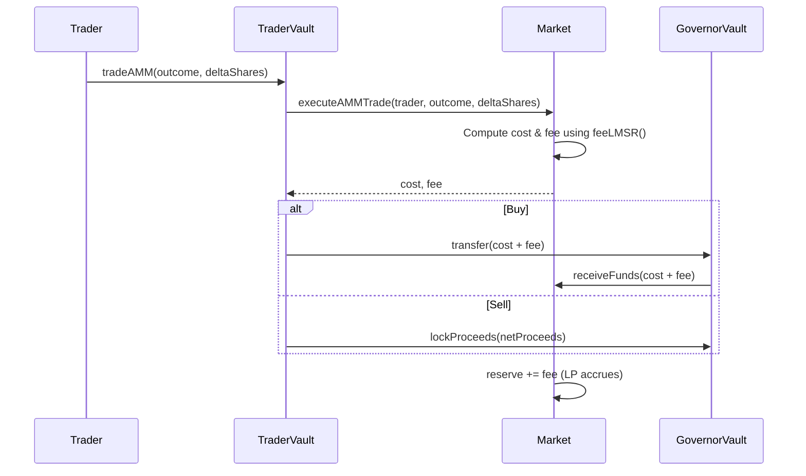
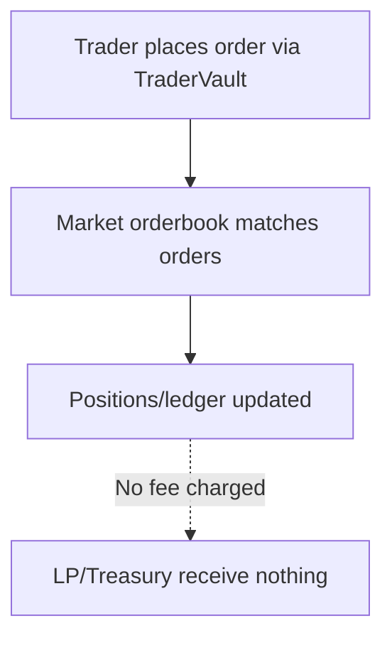

# Fee System Status Report

This report documents the current on-chain fee implementation for Sooth V4, highlights coverage gaps, and recommends next steps.

## Current State Overview

- **AMM (LMSR) fee:** Charged as `fee = |cost| * feeLMSR / 10,000` on every AMM trade. The fee rate is sourced from the Governor Vault's `defaultFeeBps` (defaults to **0.5%**) and is accumulated in the market reserve to benefit LPs. The Trader Vault debits the user for both cost and fee on buys and nets out the fee from sell proceeds. 【F:packages/contracts-evm/contracts/core/SoothMarketV4.sol†L168-L284】【F:packages/contracts-evm/contracts/core/SoothTraderVaultV4.sol†L153-L219】【F:packages/contracts-evm/contracts/core/SoothGovernorVault.sol†L45-L87】
- **Orderbook fee controller:** A dedicated `SoothFeeController` contract exists with defaults of **0.1%** orderbook fee and a **50/50 LP/treasury** split, bounded by a **2% cap**. It can compute how to split collected orderbook fees between LPs and treasury. 【F:packages/contracts-evm/contracts/core/SoothFeeController.sol†L6-L62】
- **Missing fee hookup for orderbook trades:** No orderbook fee is currently applied when orders are matched. The unified orderbook plumbing in `SoothMarketV4` and `SoothTraderVaultV4` does not query `SoothFeeController` or transfer any fee amounts, so orderbook volume is effectively fee-free today. 【F:packages/contracts-evm/contracts/core/SoothMarketV4.sol†L286-L330】【F:packages/contracts-evm/contracts/core/SoothTraderVaultV4.sol†L220-L340】

## Fee Flow Charts

### AMM Trade (Current Behavior)

### Orderbook Trade (Current Gap)

## Key Observations

1. **AMM fee path is live and accrues to LPs** via the Governor Vault reserve, but the fee rate is global per vault (not per market). 【F:packages/contracts-evm/contracts/core/SoothMarketV4.sol†L168-L284】【F:packages/contracts-evm/contracts/core/SoothGovernorVault.sol†L45-L87】
2. **Orderbook trades bypass fees entirely**, despite having a configurable controller contract ready. The system also lacks accounting to route the LP/treasury split once fees are charged. 【F:packages/contracts-evm/contracts/core/SoothFeeController.sol†L6-L62】【F:packages/contracts-evm/contracts/core/SoothTraderVaultV4.sol†L220-L340】
3. **Research proposed higher volume-based fees (2% with LP/protocol/guardian splits)**, but these figures are not reflected in the deployed defaults or code paths. 【F:packages/contracts-evm/docs/research/README.md†L66-L78】

## Recommendations & Next Steps

1. **Implement orderbook fee charging and distribution**
   - Compute `volume * orderbookFee / 10,000` for each matched fill, using `SoothFeeController.orderbookFee()`.
   - Split the fee with `lpSplitBps`, credit LP share into `SoothGovernorVault` (market reserve) and send treasury share to the configured `treasury` address.
   - Emit explicit fee events for observability and analytics.
2. **Align fee configuration surfaces**
   - Decide whether AMM and orderbook fees should share governance (both from `SoothFeeController`) or stay split between vault defaults and controller settings.
   - Add per-market overrides if different liquidity profiles warrant differentiated fees.
3. **Reconcile defaults with research targets**
   - If the 2% volume-based fee proposal is adopted, update `defaultFeeBps` and `orderbookFee` defaults (with proper caps) and add migration guidance.
   - Provide UI/SDK disclosure of effective fee rates per venue.
4. **Add monitoring and reporting**
   - Track AMM vs. orderbook fee accrual separately in events/metrics.
   - Create dashboards to confirm LP accrual and treasury receipts match expectations once orderbook fees are live.

