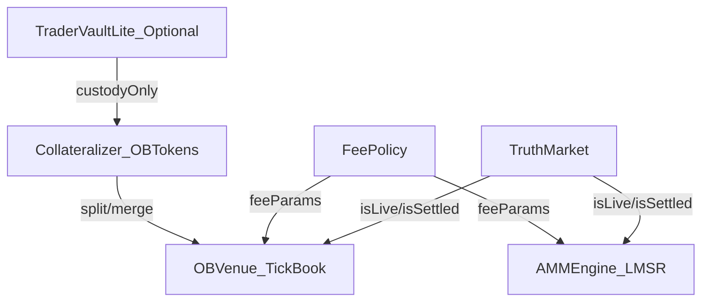

# Modular Venue Stack (Truth Market + AMM Engine + OB Venue)

**Context thread**: `bc-bd91fb1d-9131-4a02-ab23-796ae3498028`

This document reframes the original “Prediction DEX Venue (OB replacement) — one pool YES/NO with linear probability ticks” into the broader architecture we converged on:

- **Non-fungible domains** by design:
  - **AMM exposure** is a **non-transferable position domain** (supports locks and retro settlement).
  - **OB exposure** is a **token domain** (capital-efficient, self-contained venue).
- **TraderVault is optional and logicless** (at most custody/ledger), not a router for AMM/OB.
- The OB is extracted into a **standardized external module** so *non-Sooth* markets can also plug in.

---

## Scope / intent

**In scope**
- A **self-contained** Orderbook replacement venue (“tick book”) for trading YES/NO with **linear probability ticks**.
- A **standard interface** for market lifecycle gating, registration, and fee parameterization.
- A clear separation between:
  - **Truth market** (lifecycle + settlement source of truth),
  - **AMM engine** (position-based LMSR),
  - **OB venue** (token-based tick book),
  - **optional custody** (TraderVaultLite).

**Out of scope**
- Making AMM and OB outputs fungible (explicitly rejected due to lock + retro-settlement bypass).
- Building a full onchain CLOB with strict price-time priority.

---

## Summary of the approach

### Modular venue stack

- **TruthMarket**: settlement/lifecycle surface (live, settled, winning outcome, truth-time).
- **AMMEngine (LMSR)**: continuous LMSR pricing and **non-transferable positions**. May enforce:
  - sell proceeds locks,
  - dispute windows,
  - retro settlement (roots) applied to positions / accounts.
- **OBVenue (TickBook)**: self-contained trading venue with:
  - **one pool YES/NO token domain**,
  - **linear probability ticks**,
  - internal fee collection and accounting.
- **TraderVaultLite (optional)**: custody-only helper (deposit/withdraw) for UX. No matching, no LMSR logic.

### Why non-fungible domains

If AMM and OB outputs were fungible, any venue-specific constraint (e.g. “AMM sell lock”) can be bypassed by crossing into the other venue. Therefore:

- AMM produces **positions** (non-transferable).
- OB trades **tokens**.
- Any bridge between the two domains is an explicit, policy-heavy adapter (optional; not assumed here).

---

## System diagram



---

## Standard interfaces (draft)

### Minimal market lifecycle (required)

The OB venue should only require a minimal “TruthMarket” interface so it can support non-Sooth markets:

```solidity
interface ITruthMarket {
    function isLive() external view returns (bool);
    function isSettled() external view returns (bool);
    function winningOutcome() external view returns (uint8); // optional for UI
    function tStar() external view returns (uint64);         // optional for UI
}
```

### Venue registration + parameterization (required)

```solidity
interface IOBVenue {
    function registerMarket(
        address market,
        address obYesToken,
        address obNoToken,
        address feePolicy,
        address collateralizer
    ) external returns (bytes32 marketKey);
}
```

**Registration authority (recommendation)**:
- Market self-registers, or an operator returned by the market (e.g. `operator()`), to avoid third-party spoof registration.

### Fee policy (parameter provider; required)

```solidity
interface IFeePolicy {
    function quoteObFeeBps(bytes32 marketKey, uint16 startTick, uint16 endTick, uint128 amountIn)
        external
        view
        returns (uint16 feeBps, address recipient);
}
```

The venue enforces fee collection; policy only returns parameters.

---

## Key math: linear probability ticks for a YES/NO pool (OB domain)

Let the pool price be defined as a **YES/NO ratio** \(R\):

- \(R = \frac{NO}{YES}\)
- Implied probability \(p = \frac{1}{1+R}\)
- Inverse mapping \(R = \frac{1-p}{p}\)

Define a homogeneous tick grid:

- Choose \(N\) (e.g. \(N=10,000\) for 1bp increments).
- Tick index \(i \in [1, N-1]\).
- Probability at tick \(i\): \(p_i = \frac{i}{N}\).
- Ratio at tick \(i\): \(R_i = \frac{N-i}{i}\).

This gives **linear steps in probability** while the implied ratio is nonlinear.

---

## OBVenue mechanics (tick book)

Each tick \(i\) is a price level with aggregated resting liquidity on both sides:

- **Ask YES @ \(p_i\)**: makers deposit YES; takers buy YES by paying NO at rate \(R_i\).
- **Bid YES @ \(p_i\)**: makers deposit NO; takers sell YES and receive NO at rate \(R_i\).

Execution walks active ticks:

- **Buy YES**: consume `askYES` from best ask tick upward until filled or limit tick reached.
- **Sell YES**: consume `bidNO` (liquidity funded by NO) from best bid tick downward until filled or limit tick reached.

### Data structures (draft)

```solidity
struct TickLiquidity {
    uint128 askYES;
    uint128 bidNO;
}

mapping(uint16 => TickLiquidity) public ticks;
uint16 public bestAskTick;
uint16 public bestBidTick;

// Find next active tick efficiently (Uniswap-like bitmap).
uint256[391] public tickBitmap; // 10,000 / 256 bits
```

### Precision + rounding

- Use WAD math for ratios.
- Rounding should be explicitly defined and consistent (protocol safety usually rounds in favor of the pool):
  - taker pays: `ceil(matchYes * R_i)`
  - taker receives: `floor(matchYes * R_i)` for sells (or symmetric convention)

---

## Collateralization: OB token domain split/merge

The OB venue can be funded from outside via a **Collateralizer** module:

- `split(usdc)` → mint `obYES` + `obNO`
- `merge(amount)` → burn `obYES` + `obNO`, return USDC

This is independent from the AMM position domain.

If you want locks for OB cash-out, apply them at `merge()` / `redeem()`, not at swap.

---

## Lifecycle gating (pull-first; hook-optional)

**Correctness should not depend on hooks.** The venue should gate all state-changing actions via pull-checks:

- Trading allowed only when `ITruthMarket(market).isLive() == true` and `isSettled == false`.
- After settlement, trading disabled; withdrawals always allowed.

Hooks are optional optimizations for indexing/caching, but must never be required.

---

## Fees

Fee logic should be modular and symmetric across venues:

- OBVenue:
  - enforces fee collection during swap/tick-walk,
  - consults `IFeePolicy` for parameters,
  - accounts for and pays recipients (or accrues until claimed).
- AMMEngine:
  - enforces its own fee logic on LMSR cost deltas within the position domain.

Avoid passing fee values from callers (bypass risk).

---

## Tradeoffs / risks

- **Two-domain complexity**: AMM positions and OB tokens are intentionally different assets; cross-venue UX requires explicit bridging.
- **MEV**: tick-walk execution is MEV-sensitive like any onchain venue.
- **Not a true CLOB**: aggregated liquidity is not strict price-time priority; FIFO would add significant state.

---

## Suggested next steps

1. Formalize interfaces (`ITruthMarket`, `IOBVenue`, `IFeePolicy`, `ICollateralizer`) and registration authority rules.
2. Define OB token standard (ERC20) and collateralizer semantics (including any lock-on-merge if needed).
3. Specify fee accounting + claim flows (recipient types, protocol split, rebates).
4. Decide whether an explicit AMM↔OB bridge is needed (and what constraints it must enforce).
