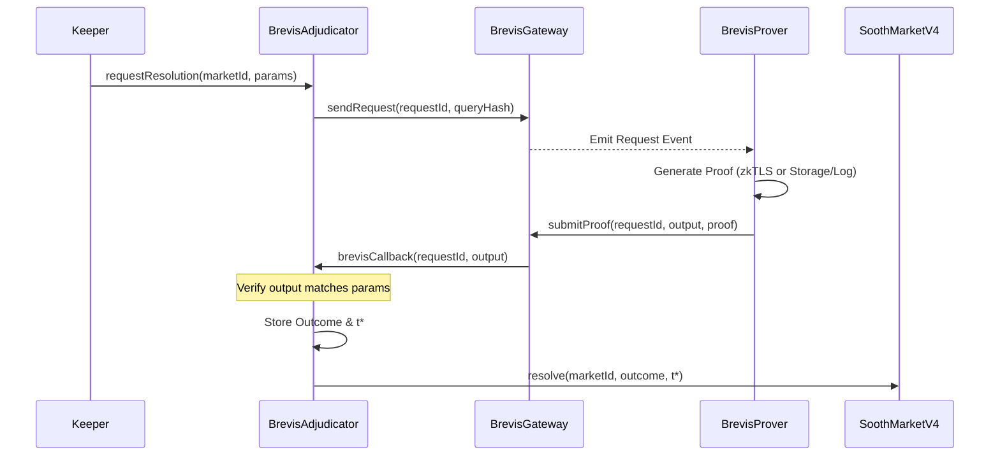
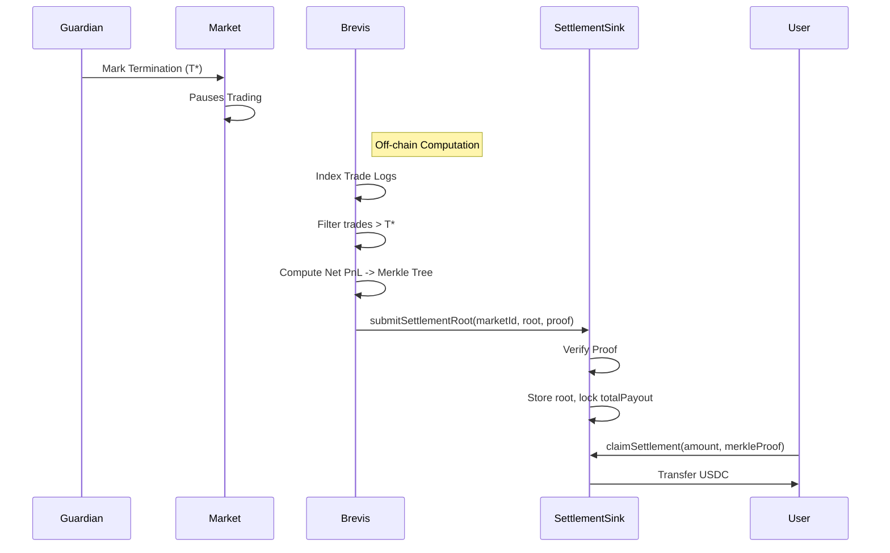

# Brevis Adjudicator & Settlement Design

## 1. Overview

This document outlines the architecture for integrating **Brevis** into the Sooth Protocol. The integration serves two distinct purposes:
1.  **Adjudication (The Truth)**: Using **zkTLS** or **ZK-Rules** to trustlessly resolve markets based on on-chain or web data.
2.  **Settlement (The Accounting)**: Using the **ZK Data Coprocessor** to compute retroactive PnL for Infinite-End Markets.

## 2. Adjudication Flow (ZK-Oracle)

The `BrevisAdjudicator` resolves a market by proving a specific condition was met (e.g. "Price > X" or "Event Y happened").

### 2.1 Interface Definition

```solidity
// IBrevisAdjudicator.sol

interface IBrevisAdjudicator {
    enum RequestStatus { None, Pending, Resolved, Failed }

    event ResolutionRequested(bytes32 indexed requestId, uint256 marketId, bytes32 queryHash);
    event MarketResolved(uint256 indexed marketId, bool outcome, uint64 terminationTime);

    /// @notice Request Brevis to check a condition for a market
    /// @param marketId The market to resolve
    /// @param queryParams Encoded params (e.g. Chainlink Feed ID, Threshold, Time Range)
    function requestResolution(uint256 marketId, bytes calldata queryParams) external payable returns (bytes32 requestId);

    /// @notice Callback from Brevis Gateway with the ZK proof result
    /// @dev Only callable by the Brevis Gateway contract
    function brevisCallback(bytes32 requestId, bytes calldata appCircuitOutput, bytes calldata circuitProof) external;
    
    /// @notice View function for Market to check status
    function getOutcome(uint256 marketId) external view returns (bool resolved, bool outcome, uint64 terminationTime);
}
```

### 2.2 Sequence Diagram



## 3. Settlement Flow (ZK-Coprocessor)

The "Retroactive Settlement" uses Brevis to compute the final net balances of all traders *after unwinding trades post-T\**.

### 3.1 The "Settlement Root" Architecture

Instead of updating every user's balance on-chain (O(N) gas), Brevis proves a **Merkle Root** of the final state. Users then claim their funds via Merkle Proofs.

### 3.2 Governor Extensions

We need to extend `SoothGovernorVault` (or create a separate `SettlementSink`) to accept these roots.

```solidity
// ISettlementSink.sol (could be implemented by GovernorVault)

interface ISettlementSink {
    event SettlementRootUpdated(uint256 indexed marketId, bytes32 merkleRoot, uint256 totalPayout);

    /// @notice Accept a ZK-proven settlement root from Brevis
    /// @param marketId The market being settled
    /// @param merkleRoot Root of the tree: {user -> amountUSDC}
    /// @param totalPayout Total USDC required for this settlement
    /// @param proof ZK proof verifying the computation of this root from Event Logs
    function submitSettlementRoot(
        uint256 marketId, 
        bytes32 merkleRoot, 
        uint256 totalPayout,
        bytes calldata proof
    ) external;

    /// @notice User claims their share from the settlement
    function claimSettlement(
        uint256 marketId,
        uint256 amount,
        bytes32[] calldata merkleProof
    ) external;
}
```

### 3.3 Sequence Diagram (Settlement)



## 4. Implementation Strategy

1.  **Phase 1 (Mock):** Implement `Adjudicator` that accepts a "God Mode" resolution for testing.
2.  **Phase 2 (Testnet):** Connect `BrevisAdjudicator` to Brevis on Base Sepolia or BNB Testnet.
3.  **Phase 3 (Settlement):** Implement the complex `SettlementSink` logic.

## 5. Key Design Decisions

*   **Push vs Pull**: We use a **Push** model for Adjudication (Adjudicator calls Market) to ensure timely update.
*   **Callback Security**: The `brevisCallback` MUST check `msg.sender == BREVIS_GATEWAY`.
*   **Settlement Gas**: Submitting the root is O(1). Claiming is O(log N). This is highly scalable.
