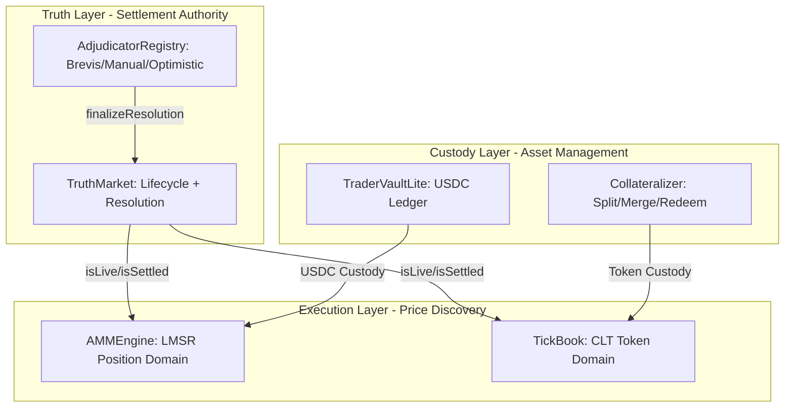

# V8 Modular Architecture: The Tri-Engine Stack

**Status**: Architectural Specification (Production-Ready)  
**Version**: 2.1.0 (Standalone)  
**Date**: 2025-12-23

---

## Table of Contents
1. [Executive Summary](#1-executive-summary)
2. [Architecture & Data Flow](#2-architecture--data-flow)
3. [Domain Isolation Principle](#3-domain-isolation-principle)
4. [TickBook: Continuous Linear Ticks](#4-tickbook-continuous-linear-ticks)
5. [Economic Model & Incentives](#5-economic-model--incentives)
6. [Settlement & Lifecycle](#6-settlement--lifecycle)
7. [Security Model & Attack Vectors](#7-security-model--attack-vectors)
8. [Gas Optimization Strategy](#8-gas-optimization-strategy)
9. [Technical Interfaces](#9-technical-interfaces)
10. [Implementation Checklist](#10-implementation-checklist)

---

## 1. Executive Summary

Sooth V8 is a **clean-slate modular architecture** that separates execution venues from settlement logic. This design enables:

- **Security-First AMM**: Non-transferable positions with 24h locks and $T^*$ retroactive settlement
- **Composable TickBook**: Transferable ERC20 tokens with Uniswap v3-style concentrated liquidity
- **Independent Venues**: AMM and TickBook operate as isolated domains with distinct security models
- **EVM Size Compliance**: Each module stays under the 24KB contract limit

**Key Innovation**: Intentional non-fungibility between execution domains. Users choose their preferred venue based on security vs composability tradeoffs.

---

## 2. Architecture & Data Flow



### Component Responsibilities

| Component | Responsibility | State Variables | Gas Profile |
|-----------|---------------|-----------------|-------------|
| **TruthMarket** | Lifecycle + $T^*$ resolution | `isLive`, `outcome`, `tStar` | ~50k (settlement) |
| **AMMEngine** | LMSR pricing + position accounting | `qYes`, `qNo`, `locks[]` | ~80k (trade) |
| **TickBook** | Tick-based liquidity + swap execution | `ticks[]`, `bitmap[]` | ~120k (multi-tick) |
| **Collateralizer** | ERC20 split/merge/redeem | `balances[]`, `totalSupply` | ~60k (split/merge) |
| **TraderVaultLite** | USDC ledger (deposit/withdraw only) | `userBalances[]` | ~40k (deposit) |

---

## 3. Domain Isolation Principle

### 3.1 The Two Execution Domains

| Aspect | AMM Domain (Positions) | TickBook Domain (Tokens) |
|--------|------------------------|---------------------|
| **Asset Type** | Non-transferable ledger entries | ERC20 outcome tokens |
| **Security Model** | 24h sell lock + $T^*$ adjustments | Instant settlement (no locks) |
| **Composability** | Internal only | Full DeFi integration |
| **LP Model** | Vault shares (ERC4626) | Fungible tick positions |
| **Target User** | Informed traders, LPs | Arbitrageurs, market makers |

### 3.2 Domain Separation Rationale

**Why Two Domains?**

The AMM and TickBook venues serve fundamentally different user needs:

**AMM Domain** is optimized for:
- Informed traders who value security over liquidity
- LPs who want retroactive settlement protection
- Markets where $T^*$ adjustments are likely

**TickBook Domain** is optimized for:
- Market makers who need transferable positions
- Arbitrageurs who want instant settlement
- DeFi composability (lending, derivatives)

**No On-Protocol Cross-Domain Conversion**: The protocol intentionally does NOT provide any bridge between AMM positions and TickBook tokens. Users must choose their venue at trade time.

### 3.3 Price Discovery Across Domains

**Challenge**: How do AMM and TickBook prices stay synchronized if domains are isolated?

**Solution (Off-Protocol Arbitrage via USDC Round-Trip)**: Arbitrage bots monitor both venues and rebalance by exiting to USDC and re-entering the other domain:
1. If `AMM_Price(YES) < TickBook_Price(YES)`:
   - Buy on AMM (get position exposure)
   - If selling proceeds are locked, wait for lock expiry
   - Exit the AMM domain to USDC
   - Split USDC into TickBook tokens via `Collateralizer.split(...)`
   - Sell YES on TickBook
2. If `AMM_Price(YES) > TickBook_Price(YES)`:
   - Buy YES on TickBook (get transferable tokens)
   - Redeem/sell to USDC in the TickBook/custody domain
   - Enter the AMM domain with USDC and sell exposure on AMM (subject to locks)

**Expected Spread**: 1-3% due to lock duration and gas costs.

---

## 4. TickBook: Continuous Linear Ticks

### 4.1 Mathematical Foundation

The CLT model uses a **fixed 10,000-tick grid** linear in probability space.

**Tick-to-Probability Mapping**:
$$p_i = \frac{i}{N} \quad \text{where } N = 10,000$$

**Implied Price Ratio**:
$$R_i = \frac{p_i}{1 - p_i} = \frac{i}{N - i}$$

**Virtual Reserves** (for liquidity $L$ at tick $i$):
$$x_{YES} = L \cdot \sqrt{\frac{1-p_i}{p_i}} = L \cdot \sqrt{\frac{N-i}{i}}$$
$$y_{NO} = L \cdot \sqrt{\frac{p_i}{1-p_i}} = L \cdot \sqrt{\frac{i}{N-i}}$$

### 4.2 Swap Execution Algorithm

**Input**: `amountIn`, `isBuy`, `limitTick`  
**Output**: `amountOut`

```
1. Load current tick i and liquidity L
2. Calculate distance to tick boundary:
   - If buying YES: distance = sqrt(k) * (sqrt(p_{i+1}) - sqrt(p_i))
3. If amountIn < distance:
   - Execute within tick (continuous curve)
   - Update p_current
4. Else:
   - Consume all liquidity at tick i
   - Find next active tick via bitmap
   - Repeat from step 2
5. Apply fee (pro-rata to LPs at each tick)
```

### 4.3 Tick Bitmap (Gas Optimization)

**Problem**: Finding the next active tick in a 10,000-element array costs ~391 SLOADs.

**Solution**: Two-level bitmap:
```solidity
uint256[391] public tickBitmap;      // Level 1: 10,000 / 256
uint256[2] public tickBitmapSummary; // Level 2: 391 / 256
```

**Lookup Algorithm**:
1. Check `tickBitmapSummary` to find active Level 1 word (~1 SLOAD)
2. Check `tickBitmap[word]` to find exact tick (~1 SLOAD)
3. **Total**: ~2 SLOADs vs 391 naive

**Gas Savings**: ~7,800 gas per tick-walk (391 × 20 gas/SLOAD)

---

## 5. Economic Model & Incentives

### 5.1 Fee Structure

| Fee Type | Rate | Recipient | Purpose |
|----------|------|-----------|---------|
| **AMM Swap Fee** | 0.3% | LP Vault | Compensate for impermanent loss |
| **TickBook Maker Fee** | 0% (rebate) | Tick Makers | Incentivize tight spreads |
| **TickBook Taker Fee** | 0.2% | Protocol + Tick Makers | Revenue + maker rebate |


### 5.2 LP Incentive Alignment

**AMM LPs**:
- Earn fees on AMM trades within the position domain
- Exposed to impermanent loss if market moves
- Protected by 24h lock (prevents informed trading front-running)

**Tick Makers**:
- Earn fees only on trades that execute at their tick
- Compete on spread (tighter = more fills)

### 5.3 Capital Efficiency Comparison

| Metric | Uniswap v3 | Sooth V8 TickBook | Sooth V8 AMM |
|--------|------------|-------------|--------------|
| **Position Type** | NFT | Fungible | Vault Shares |
| **Capital Utilization** | ~40% (wide ranges) | ~80% (1bp ticks) | ~60% (LMSR curve) |
| **Gas per LP Action** | ~180k | ~120k | ~80k |
| **Composability** | Limited (NFT) | High (ERC20-like) | Medium (ERC4626) |

---

## 6. Settlement & Lifecycle

### 6.1 State Machine

```
CREATED → LIVE → SETTLING → SETTLED → FINALIZED
   ↓        ↓        ↓          ↓         ↓
Deploy  Trading  Adjudication  Payout  Archive
```

### 6.2 Retroactive Settlement ($T^*$) Flow

**Scenario**: Market resolves at `t=100`, but truth actually occurred at `t=50` ($T^*$).

**AMM Domain**:
1. All positions after $T^*$ are adjusted via Merkle proof
2. Traders who bought YES after $T^*$ get refunded
3. LPs compensated for losses via protocol insurance

**TickBook Domain (PvP; No Retro-Settlement)**:
- The TickBook token domain does **not** apply $T^*$ adjustments. TickBook is a PvP venue: token holders accept that trades are final within the token domain, and redemption is based only on the canonical settlement outcome.
- Post-settlement redemption uses `ITruthMarket.getRedemptionValue(outcome)` (typically binary 0/1 for NO/YES; optionally supports INVALID-style non-binary payout), but **never** a retroactive $P_{T^*}$ haircut.

### 6.3 Failure Modes & Recovery

| Failure | Impact | Mitigation |
|---------|--------|------------|
| **Oracle offline** | Settlement delayed | Fallback to manual adjudication after 7 days |
| **Adjudicator compromised** | Wrong outcome | Guardian veto (48h window) |
| **Collateralizer drained** | Redemption fails | Circuit breaker + insurance fund |
| **AMM underwater** | LP losses | Honest Floor Model (documented in V6) |

---

## 7. Security Model & Attack Vectors

### 7.1 Threat Matrix

| Attack | Vector | Mitigation | Severity |
|--------|--------|------------|----------|
| **Oracle Front-Running** | Trade before settlement | 24h sell lock on AMM | High |
| **Tick Sandwich** | Front-run large TickBook swap | Pro-rata fee distribution | Medium |
| **Fake Market Registration** | Spoof market to phish users | Self-registration only | High |
| **Precision Drain** | Exploit rounding errors | Protocol-biased rounding | Medium |
| **$T^*$ Manipulation** | Adjudicator lies about truth-time | Multi-sig + guardian veto | Critical |

### 7.2 Invariant Enforcement

**Critical Invariants** (must hold at all times):
```solidity
// Token symmetry
assert(totalSupply(YES) == totalSupply(NO));

// Solvency
// General form: collateral must cover total redemption obligation at settlement.
// (Exact units depend on token decimals and redemption value precision.)
assert(
    collateralizer.usdcBalance >=
        totalSupply(YES) * getRedemptionValue(YES) +
        totalSupply(NO) * getRedemptionValue(NO)
);

// No-arbitrage within venue
assert(abs(priceYES + priceNO - 1.0) < EPSILON);

// Domain isolation
assert(ammEngine.address != tickBook.address);
```

### 7.3 Audit Checklist

- [ ] Reentrancy guards on all state-changing functions
- [ ] Integer overflow checks (even with Solidity 0.8+)
- [ ] Access control on admin functions (Ownable2Step)
- [ ] Pausability for emergency stops
- [ ] Upgrade path via proxy (UUPS or Transparent)
- [ ] Fuzz testing on swap math (Echidna/Foundry)
- [ ] Formal verification of invariants (Certora)

---

## 8. Gas Optimization Strategy

### 8.1 Benchmarks (Estimated)

| Operation | Previous (Monolithic) | V8 (Modular) | Savings |
|-----------|----------------------|--------------|---------|
| **AMM Swap** | ~120k | ~80k | 33% |
| **TickBook Single-Tick Swap** | N/A | ~90k | New feature |
| **TickBook Multi-Tick Swap** | N/A | ~120k | Competitive with Uniswap v3 |
| **Split/Merge** | ~100k | ~60k | 40% |
| **LP Deposit** | ~150k | ~70k | 53% |

### 8.2 Optimization Techniques

1. **Packed Storage**: Store tick data in `uint256` slots
   ```solidity
   struct TickData {
       uint128 liquidityYES; // 128 bits
       uint128 liquidityNO;  // 128 bits
   } // Total: 256 bits (1 slot)
   ```

2. **Bitmap Caching**: Cache bitmap words in memory during multi-tick walks

3. **Lazy Updates**: Only update global state on net liquidity changes

4. **Batch Operations**: Allow multi-market deposits in single tx

---

---

## 9. Technical Interfaces

### 9.1 Core Interfaces

```solidity
// ============================================
// Truth Layer
// ============================================

interface ITruthMarket {
    /// @notice Check if market is accepting trades
    function isLive() external view returns (bool);
    
    /// @notice Check if market has been settled
    function isSettled() external view returns (bool);
    
    /// @notice Get winning outcome (0=NO, 1=YES, 2=INVALID)
    function winningOutcome() external view returns (uint8);
    
    /// @notice Get retroactive truth-time (0 if not applicable)
    function tStar() external view returns (uint64);
    
    /// @notice Get redemption value per token (WAD precision)
    /// @param outcome 0=NO, 1=YES
    function getRedemptionValue(uint8 outcome) external view returns (uint256);
}

// ============================================
// AMM Engine (Position Domain)
// ============================================

interface IAMMEngine {
    /// @notice Execute trade in position domain
    /// @param market Market address
    /// @param deltaShares Positive=buy, negative=sell (WAD)
    /// @param maxCost Maximum USDC to spend (WAD)
    /// @return actualCost Actual USDC spent/received
    function tradePositions(
        address market,
        int256 deltaShares,
        uint256 maxCost
    ) external returns (uint256 actualCost);
    
    /// @notice Claim unlocked sell proceeds
    /// @param market Market address
    /// @return amount USDC claimed
    function claimUnlocked(address market) external returns (uint256 amount);
    
    /// @notice Get user's position and lock status
    function getPosition(address market, address user) 
        external 
        view 
        returns (
            int256 shares,
            uint256 lockedProceeds,
            uint64 lockExpiry
        );
}

// ============================================
// TickBook (Token Domain)
// ============================================

interface ITickBook {
    /// @notice Execute swap in token domain
    /// @param marketKey Unique market identifier
    /// @param isBuy true=buy YES, false=sell YES
    /// @param amountIn Input token amount
    /// @param limitTick Maximum/minimum tick to execute
    /// @return amountOut Output token amount
    function swap(
        bytes32 marketKey,
        bool isBuy,
        uint256 amountIn,
        uint16 limitTick
    ) external returns (uint256 amountOut);
    
    /// @notice Add concentrated liquidity at specific tick
    /// @param marketKey Market identifier
    /// @param tickIndex Tick to provide liquidity (0-9999)
    /// @param amount Liquidity amount (in YES+NO pairs)
    function addLiquidity(
        bytes32 marketKey,
        uint16 tickIndex,
        uint256 amount
    ) external;
    
    /// @notice Remove liquidity from tick
    function removeLiquidity(
        bytes32 marketKey,
        uint16 tickIndex,
        uint256 amount
    ) external returns (uint256 yesAmount, uint256 noAmount);
    
    /// @notice Get quote for swap (view-only)
    function getQuote(
        bytes32 marketKey,
        bool isBuy,
        uint256 amountIn,
        uint16 limitTick
    ) external view returns (
        uint256 amountOut,
        uint16 finalTick,
        uint256 feeAmount
    );
}

// ============================================
// Collateralizer (Custody Layer)
// ============================================

interface ICollateralizer {
    /// @notice Split USDC into YES+NO tokens
    /// @param market Market address
    /// @param amount USDC amount (creates equal YES+NO)
    function split(address market, uint256 amount) external;
    
    /// @notice Merge YES+NO tokens back to USDC
    /// @param market Market address
    /// @param amount Token amount (must have equal YES+NO)
    function merge(address market, uint256 amount) external;
    
    /// @notice Redeem winning tokens post-settlement
    /// @param market Market address
    /// @param amount Token amount to redeem
    /// @return usdcAmount USDC received
    function redeem(
        address market,
        uint256 amount
    ) external returns (uint256 usdcAmount);
}
```

---

## 10. Implementation Checklist

### Phase 1: Foundation
- [ ] Implement `ITruthMarket` interface
- [ ] Deploy `Collateralizer` with split/merge
- [ ] Deploy `TraderVaultLite` (USDC ledger only)
- [ ] Write unit tests for custody layer

### Phase 2: AMM Engine
- [ ] Implement LMSR math library
- [ ] Implement 24h sell lock mechanism
- [ ] Add $T^*$ settlement logic
- [ ] Fuzz test position accounting

### Phase 3: TickBook
- [ ] Implement tick bitmap
- [ ] Write swap execution algorithm
- [ ] Add liquidity management
- [ ] Gas benchmark vs Uniswap v3

### Phase 4: Integration
- [ ] Connect venues to TruthMarket
- [ ] Implement fee distribution
- [ ] Add emergency pause
- [ ] External audit (Certora/Trail of Bits)

---

## Appendix A: Design Rationale

**Why separate AMM and TickBook?**
- Security (locks) vs Efficiency (composability) are fundamentally incompatible
- Modular design allows independent venue development
- Reduces contract size (EVM 24KB limit)
- Users can choose the venue that matches their needs

**Why 10,000 ticks?**
- 1bp precision matches traditional finance
- Fits in `uint16` (gas efficient)
- Bitmap fits in reasonable storage (~391 slots)

**Why pro-rata fees instead of FIFO?**
- Eliminates MEV from tick priority
- Fairer for retail LPs
- Simpler implementation

**Why no cross-domain bridge?**
- Prevents lock bypass attacks
- Maintains clean security boundaries
- Simplifies protocol complexity
- Users can manually exit and re-enter if needed

---

## Appendix B: References

- Uniswap v3 Whitepaper: [Concentrated Liquidity](https://uniswap.org/whitepaper-v3.pdf)
- Hanson LMSR: [Logarithmic Market Scoring Rules](http://mason.gmu.edu/~rhanson/mktscore.pdf)
- ERC4626: [Tokenized Vault Standard](https://eips.ethereum.org/EIPS/eip-4626)
- ADR-008: WAD Math Precision Rules
- V8 Note: `LOCKED_PROCEEDS_SPENDABILITY.md` (lock-on-sell spendability policy)

---

**Document Status**: Ready for Implementation Review  
**Next Steps**: Protocol team review → Interface finalization → Solidity implementation  
**Estimated Implementation**: 4-6 weeks (with testing)
