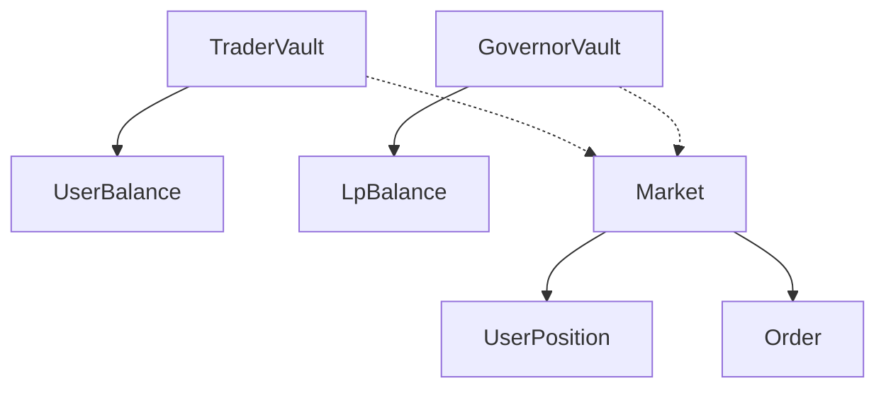

# Solana Program Architecture

## Overview

The Sooth Protocol Solana program implements a prediction market with LMSR (Logarithmic Market Scoring Rule) pricing, dual vaults (Trader & Governor), and an orderbook system.

## Account Structure



### Core Accounts

#### TraderVault (PDA: `["trader_vault"]`)

- Global singleton for all traders
- Tracks total deposits
- Authority: program deployer

#### UserBalance (PDA: `["user_balance", user_pubkey]`)

- Per-user balance tracking
- `free_balance`: Available USDC
- `locked_balance`: Collateral in orders

#### GovernorVault (PDA: `["governor_vault"]`)

- LP liquidity pool
- ERC4626-style share accounting
- Configurable parameters (b_base, fee_bps, reserve_factor)

#### LpBalance (PDA: `["lp_balance", lp_pubkey]`)

- Per-LP share balance
- Redeemable for proportional vault assets

#### Market (PDA: `["market", market_id]`)

- Prediction market instance
- LMSR state (q_yes, q_no)
- Settlement status

#### UserPosition (PDA: `["position", user_pubkey, market_pubkey]`)

- Per-user, per-market position
- YES/NO token balances

#### Order (PDA: `["order", maker_pubkey, order_id]`)

- Limit order
- Tracks filled amount
- Cancellable by maker

## LMSR Pricing

### Fixed-Point Math

- Precision: 59.18 (1e18 = 1.0)
- All prices in WAD format
- Checked arithmetic throughout

### Cost Function

```
C(q) = b * ln(e^(q_yes/b) + e^(q_no/b))
```

### Price Calculation

```
P(YES) = e^(q_yes/b) / (e^(q_yes/b) + e^(q_no/b))
```

### Log-Sum-Exp Trick

Prevents overflow by normalizing exponents:

```
max_val = max(a, b)
ln(e^a + e^b) = max_val + ln(e^(a-max_val) + e^(b-max_val))
```

## Orderbook Design

### Order PDA Approach

- Each order = separate account
- No automatic matching (CU constraints)
- Manual matching via `match_orders`

### Matching Logic

1. Validate same market
2. Check opposite outcomes (YES vs NO)
3. Verify prices cross: `price_a + price_b >= 1e18`
4. Calculate match amount: `min(remaining_a, remaining_b)`
5. Complete set creation: mint YES to buyer, NO to seller
6. Update filled amounts

### Collateral

- Locked in `UserBalance.locked_balance`
- Refunded on cancel
- Released on match

## Token Flow

### Deposit (Trader)

```
User USDC → Vault USDC
UserBalance.free_balance += amount
```

### Withdraw (Trader)

```
Vault USDC → User USDC
UserBalance.free_balance -= amount
```

### LP Deposit

```
LP USDC → Vault USDC
shares = (amount * totalSupply) / totalAssets
LpBalance.shares += shares
```

### LP Withdraw

```
Vault USDC → LP USDC
shares = (amount * totalSupply) / totalAssets
LpBalance.shares -= shares
```

### Trade (AMM)

```
Buy: UserBalance.free_balance -= cost
     UserPosition.yes_balance += shares

Sell: UserPosition.yes_balance -= shares
      UserBalance.free_balance += refund
```

### Order Creation

```
UserBalance.free_balance -= collateral
UserBalance.locked_balance += collateral
```

### Order Match

```
UserPosition.yes_balance += amount (YES buyer)
UserPosition.no_balance += amount (NO buyer)
```

## Security Considerations

### Checked Arithmetic

All operations use `checked_*` methods to prevent overflow/underflow.

### PDA Signers

- TraderVault signs withdrawals
- GovernorVault signs LP withdrawals

### Access Control

- Market settlement: only governor
- Order cancellation: only maker
- Vault initialization: only authority

### Slippage Protection

- AMM trades: `max_cost` parameter
- Orders: price limits

## CU Budget

| Instruction          | Estimated CU     |
| -------------------- | ---------------- |
| `deposit`            | ~5k              |
| `withdraw`           | ~8k              |
| `lp_deposit`         | ~5k              |
| `lp_withdraw`        | ~8k              |
| `create_market`      | ~10k             |
| `trade`              | ~20k (LMSR math) |
| `create_limit_order` | ~5k              |
| `cancel_order`       | ~5k              |
| `match_orders`       | ~15k             |

## Limitations

1. **No Automatic Matching**: Requires keeper bots or manual matching
2. **Single Market Type**: Binary outcomes only
3. **No Partial Fills on Cancel**: Full remaining amount refunded
4. **Fixed Precision**: 59.18 may lose precision on very small amounts

## Future Enhancements

- [ ] Keeper bot infrastructure
- [ ] Multi-outcome markets
- [ ] Fee collection mechanism
- [ ] Cranking for settlement
- [ ] Oracle integration
